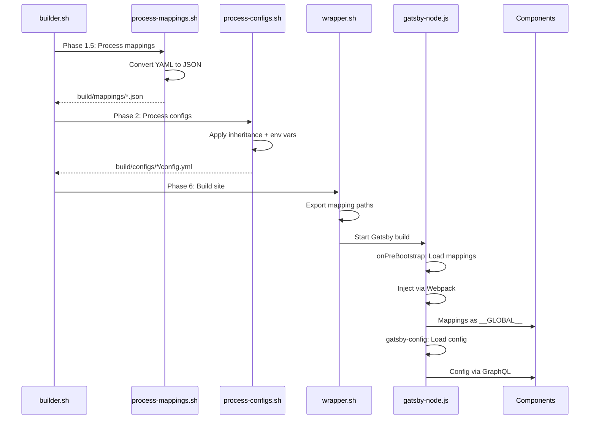

# Configuration System Documentation

## Overview

This directory contains the complete configuration system for the getHarsh ecosystem - a multi-domain website platform with comprehensive Schema.org integration. The system uses a **hybrid approach** combining Protocol Buffers for type-safe schema definitions with YAML files for human-readable configuration.

## 📚 Documentation Structure

| Document | Purpose | Start Here If... |
|----------|---------|------------------|
| **This file** (CONFIG.md) | System architecture and inheritance model | You want to understand how the configuration system works |
| [SCHEMA-ORG-EXAMPLES.md](SCHEMA-ORG-EXAMPLES.md) | Schema.org entity configuration guide | You need to configure entities, relationships, or page schemas |
| [GTM-EXAMPLES.md](GTM-EXAMPLES.md) | Google Tag Manager configuration guide | You need to set up analytics, tracking, or conversions |
| [CONSENT-EXAMPLES.md](CONSENT-EXAMPLES.md) | Consent management configuration guide | You need GDPR compliance or cookie consent setup |
| [ARIA-EXAMPLES.md](ARIA-EXAMPLES.md) | Accessibility configuration guide | You need WCAG compliance or accessibility features |
| [schema/SCHEMA.md](schema/SCHEMA.md#the-architecture) | Proto schema philosophy & architecture | You need to understand or modify the proto definitions |
| [schema/services.proto](schema/services.proto) | Services configuration schema | You need to configure AI transformation services |
| [schema/schema-mappings.yml](schema/schema-mappings.yml) | Enum-to-Schema.org dictionary | You need to see the ~250+ automatic mappings |
| [schema/gtm-mappings.yml](schema/gtm-mappings.yml) | GTM enum and event mappings | You need to see GTM-specific mappings |
| [schema/consent-mappings.yml](schema/consent-mappings.yml) | Consent and legal framework mappings | You need to see consent-related mappings |
| [schema/aria-mappings.yml](schema/aria-mappings.yml) | ARIA and WCAG mappings | You need to see accessibility mappings |
| [tools/TOOLS.md](tools/TOOLS.md#tool-details) | Validation and processing tools | You need to validate or process configurations |
| [../GUARDRAILS.md](../GUARDRAILS.md#common-workflows) | Ecosystem operations | You need to understand build patterns and workflows |
| [../src/SEARCH.md](../src/SEARCH.md) | Search system implementation | You need to configure or understand search functionality |

## 🚀 Quick Start

### 1. Understanding the Ecosystem

The getHarsh ecosystem represents a unique case where:
- **getHarsh** = Person (Harsh) + Brand + Ecosystem name
- **RTEPL** owns the getHarsh brand and most domains
- **DSPL** is a separate entity, also founded by Harsh

See [SCHEMA-ORG-EXAMPLES.md#ecosystem-philosophy](SCHEMA-ORG-EXAMPLES.md#ecosystem-philosophy) for the complete picture.

### 2. Configuring an Entity

```yaml
# Example: Domain configuration
schema_org_entity:
  type: "Person"  # or "Organization", "ResearchProject", etc.
  additional_types: ["WebSite", "Brand"]
  custom_properties:
    name: "Harsh"
    # ... other Schema.org properties

pages_schema:
  "/projects":
    type: "CollectionPage"
    additional_types: ["ItemList"]
```

See [SCHEMA-ORG-EXAMPLES.md#quick-start](SCHEMA-ORG-EXAMPLES.md#quick-start) for patterns.

### 3. Validating Configuration

```bash
cd tools
./validate.sh ../../getHarsh.in/config.yml --env-file=../../.env
```

See [tools/TOOLS.md](tools/TOOLS.md) for all available tools.

## Core Vision

A centralized build engine (getHarsh) that powers multiple independent websites across domains, blogs, and project documentation sites, with each maintaining its own Git repository while being orchestrated through a unified system. The engine transforms centralized content from master_posts into fully-built static websites based on entity-specific configurations.

## Ecosystem Structure

### Entities
- **5 Domains**: getHarsh.in, causality.in, rawThoughts.in, sleepwalker.in, daostudio.in
- **10 Blog Subdomains**: blog.[domain].in for each domain
- **9 Active Projects**: Distributed across domains in PROJECTS/ folders
- **1 Engine**: getHarsh (contains all build logic and schemas)
- **1 Content Store**: master_posts (inside getHarsh, independent Git)

### Pattern-Based Repository Classification
All operations use patterns, NO hardcoded entity names. For detailed pattern functions and usage, see **[GUARDRAILS.md - Pattern Detection](../../GUARDRAILS.md#pattern-detection)**.

- **Domain Pattern**: `^[^/]+\.in$` (excludes blog.*)
- **Blog Pattern**: `^blog\.[^/]+\.in$`
- **Project Pattern**: `/PROJECTS/[^/]+$`
- **Engine Pattern**: `^getHarsh$`
- **Content Pattern**: `^master_posts$`

## Architecture

### Multi-Level Inheritance Model

**Key Insight**: Ecosystem defaults live in the ENGINE, not in any domain repository.

```text
getHarsh/config/ecosystem-defaults.yml    # Engine repository (main branch)
    │
    ├──→ getHarsh.in/config.yml          # Domain config (main branch)
    ├──→ causality.in/config.yml         # Domain config (main branch)
    │    ├──→ causality.in/PROJECTS/HENA/config.yml        # Project config (site branch)
    │    │    └──→ HENA/docs/config.yml                    # Docs config (main branch/tag)
    │    └──→ causality.in/PROJECTS/JARVIS-kernel/config.yml # Project config (site branch)
    ├──→ rawThoughts.in/config.yml       # Domain config (main branch)
    │    ├──→ rawThoughts.in/PROJECTS/jarvisMCP/config.yml  # Project config (site branch)
    │    └──→ rawThoughts.in/PROJECTS/rteplMCP/config.yml   # Project config (site branch)
    ├──→ sleepwalker.in/config.yml       # Domain config (main branch)
    └──→ daostudio.in/config.yml         # Domain config (main branch)
```

**CRITICAL Branch Rules** (Pattern-based, not hardcoded!):
- **Domains** (Pattern: `*.in` but not `blog.*`): config.yml in main branch only
- **Blogs** (Pattern: `blog.*.in`): config.yml in main branch only
- **Projects** (Pattern: `*/PROJECTS/*`): config.yml in site branch, docs/ in main

## CRITICAL: Project Repository Architecture

**Triple Git Structure**: Projects in PROJECTS/ folders are:
- **Google Drive synced**: For collaboration and backup
- **Independent Git repositories**: Each project has own Git history
- **Symlinked from domains**: Domain PROJECTS/ folders contain symlinks to project locations

**Git Pollution Prevention**:
- ALL domain .gitignore files MUST exclude `PROJECTS/` directory
- Domain repos never track project files to prevent Git tree pollution  
- Projects manage their own versioning independently
- Configuration inheritance: ecosystem → domain → project

**Pattern-Based Branching Strategy**:
For complete branch management and atomic operations, see **[GUARDRAILS.md - Branch Management](../../GUARDRAILS.md#branch-management)** and **[Atomic Operations](../../GUARDRAILS.md#atomic-operations)**.

- **Domains/Blogs**: Main branch only (they are output containers)
- **Projects**: main (code+docs) + site branch (config+output)
- **Content Sources**:
  - Marketing: master_posts/pages/[entity]/
  - Technical docs: [project]/docs/ (from specified version)

**Example: causality.in ecosystem**
```text
causality.in/config.yml
    ├──→ blog.causality.in/config.yml
    ├──→ causality.in/HENA/config.yml
    └──→ causality.in/JARVIS/config.yml
```

**Clean Architecture**:
- Each repository has exactly ONE config.yml
- No dual-purpose files
- Clear inheritance path
- Projects are separate repositories but inherit domain config
- Projects do NOT have their own blogs

## Data Flow Architecture

The getHarsh ecosystem uses three distinct, complementary data flows that work together to provide configuration, translations, and runtime behaviors to components. Understanding this separation is critical for proper system usage.

### Three Distinct Data Flows

```mermaid
graph TB
    subgraph "1. Configuration Values"
        CV1[config.yml] --> CV2[process-configs.sh]
        CV2 --> CV3[gatsby-config.ts]
        CV3 --> CV4[GraphQL siteMetadata]
        CV4 --> CV5[useConfig hook]
        CV5 --> CV6[Components]
    end
    
    subgraph "2. Enum Translations"
        ET1[mapping YAMLs] --> ET2[process-mappings.sh]
        ET2 --> ET3[JSON files]
        ET3 --> ET4[Webpack DefinePlugin]
        ET4 --> ET5[__GLOBAL__ constants]
        ET5 --> ET6[utils/mappings]
        ET6 --> ET7[Hooks]
    end
    
    subgraph "3. Runtime Behaviors"
        RB1[Hooks] --> RB2[Runtime Functions]
        RB2 --> RB3[Components]
    end
```



### Information Flow by System

| System | Purpose | Example | Data Flow | Access Method |
|--------|---------|---------|-----------|---------------|
| **Config Values** | Actual configuration settings | `container_id: "GTM-ABC123"` | YAML → GraphQL → Components | `useConfig()` |
| **Enum Mappings** | Proto enum to string translations | `TRIGGER_TYPE_CLICK → "Click"` | YAML → Webpack → Global | `getMappedValue()` |
| **Runtime Behaviors** | Component utilities & functions | `trackEvent()`, `trapFocus()` | Direct hook implementation | Hook imports |

### Hook Data Sources & Responsibilities

Each hook has distinct data sources and serves a specific purpose:

#### useConfig - Central Configuration Hub
- **Source**: GraphQL (siteMetadata)
- **Provides**: ALL configuration values
- **Example data**: `gtm_container_id`, `enable_consent_banner`, `services_enabled`
- **Purpose**: Single source of truth for all config values
- **File**: [src/src/hooks/useConfig.ts](../src/src/hooks/useConfig.ts)

#### useGTM - Event Tracking Implementation
- **Sources**: GraphQL config + Runtime state
- **Config from GraphQL**: `gtm_container_id`
- **Runtime functions**: `trackEvent()`, `trackConversion()`
- **Purpose**: GTM tracking behaviors (not configuration)
- **File**: [src/src/hooks/useGTM.ts](../src/src/hooks/useGTM.ts)

#### useSchema - Schema.org Builder
- **Sources**: GraphQL + Global mappings
- **Config from GraphQL**: Basic metadata
- **Mappings**: `__SCHEMA_MAPPINGS__` for translations
- **Functions**: `buildArticleSchema()`, `renderJsonLd()`
- **Purpose**: Build structured data
- **File**: [src/src/hooks/useSchema.ts](../src/src/hooks/useSchema.ts)

#### useAccessibility - Runtime ARIA Behaviors
- **Sources**: Environment variables only
- **Config**: `GATSBY_ARIA_COMPLIANCE_LEVEL`
- **Functions**: `trapFocus()`, `announce()`, `getSkipLinks()`
- **Purpose**: Runtime accessibility utilities
- **File**: [src/src/hooks/useAccessibility.ts](../src/src/hooks/useAccessibility.ts)

### Mapping Files vs Configuration

**Key Architecture Decision**: Mappings and configurations serve completely different purposes:

1. **Mapping YAMLs** (Global, processed once):
   - [schema-mappings.yml](schema/schema-mappings.yml) - ~300+ enum-to-Schema.org mappings
   - [aria-mappings.yml](schema/aria-mappings.yml) - ARIA patterns and WCAG mappings
   - [gtm-mappings.yml](schema/gtm-mappings.yml) - GTM event and dimension mappings
   - **Purpose**: Translate proto enums to human-readable strings
   - **Processing**: Phase 1.5 by `process-mappings.sh`
   - **Output**: `build/mappings/*.json`

2. **Configuration YAMLs** (Entity-specific, inherited):
   - ecosystem-defaults.yml, config.yml files
   - **Purpose**: Provide actual configuration values
   - **Processing**: Phase 2 by `process-configs.sh`
   - **Output**: `build/configs/[entity]/[mode]/config.yml`

### GTM and ARIA Configuration Sections

When adding `gtm_config` and `aria_config` to ecosystem-defaults.yml, remember they provide VALUES, not translations:

```yaml
# GTM Configuration VALUES (consumed by useConfig via GraphQL)
gtm_config:
  container:
    container_id: "${GTM_CONTAINER_ID}"  # Actual container ID
    environment: "production"             # Build environment
  data_layer:
    enable_data_layer: true              # Feature flag
    page_metadata:
      include_title: true                # What to track

# ARIA Configuration VALUES (consumed by useConfig via GraphQL)
aria_config:
  core:
    enabled: true                        # Feature flag
    compliance_level: "AA"               # WCAG level
  keyboard:
    skip_links:                          # Skip link config
      - text: "Skip to main"
        target: "#main"
```

### Build-Time Sequence



### Key Insight: No Redundancy

The investigation confirms there is NO redundancy in the system. Each layer serves a distinct purpose:
- **Proto schemas** define structure (what CAN exist)
- **Mapping YAMLs** provide translations (enum → string)
- **Config YAMLs** contain values (actual settings)
- **Hooks** provide behaviors (runtime functions)

This architecture ensures type safety, build-time optimization, and clean separation of concerns.

### Critical Implementation Pattern: Using the Right Highway

When implementing features that need enum information, use the correct highway:

| Need | Use Highway | Location | Example |
|------|------------|----------|---------|
| Field validation | Highway 1 | `build/schemas/*.json` | Validate field types |
| Enum string names | Highway 2 | `build/mappings/*.json` | Get `CONTENT_TYPE_TUTORIAL` |
| Enum labels | Highway 2 | `build/mappings/*.json` | Get "Tutorial" label |
| Config values | Highway 3 | `build/configs/*/config.yml` | Get actual settings |

**CRITICAL for CMS Generation**:
- JSON schemas (Highway 1) only contain numeric enum values (protoc-gen-jsonschema limitation)
- Enum string names are in mapping JSONs (Highway 2) - this is by design, not a workaround
- This separation follows 2024-2025 best practices for proto-driven architectures

Example for CMS dropdown generation:
```javascript
// ❌ WRONG - JSON schemas only have numbers
const schema = require('build/schemas/ArticleConfig.schema.json');
// schema.properties.content_type.enum = [0, 1, 2, ...] // No string names!

// ✅ CORRECT - Mapping JSONs have string names
const mappings = require('build/mappings/schema-mappings.json');
// mappings.content_types = { "CONTENT_TYPE_TUTORIAL": "HowTo", ... }
```

### Technology Stack

1. **Protocol Buffers (.proto)** - Define the configuration contract
2. **YAML Files** - Store actual configuration values
3. **JSON Schema** - Generated from Protobuf for runtime validation
4. **Build-time Validation** - Ensures configs are valid before deployment
5. **Schema.org Integration** - Rich semantic markup via [schema-mappings.yml](schema/schema-mappings.yml)
6. **Google Tag Manager** - Analytics and conversion tracking via [gtm.proto](schema/gtm.proto)
7. **Consent Management** - GDPR/CCPA compliance via [consent.proto](schema/consent.proto)
8. **Accessibility (ARIA)** - WCAG 2.1 AA compliance via [aria.proto](schema/aria.proto)
9. **Comprehensive Ecosystem Configuration** - Full-stack site management
10. **Decap CMS Integration** - Content management with proto-driven field configuration

### Decap CMS Configuration Generation

The system automatically generates Decap CMS configuration from proto schemas:

- **ArticleConfig Schema**: 300+ fields exposed in Decap CMS interface
- **Collection Templates**: Generated from proto definitions
- **Field Widgets**: Automatically mapped from proto types
- **Validation Rules**: Proto constraints enforced in CMS
- **generate-decap-config.js**: Creates static/admin/config.yml from schemas

This ensures the CMS interface always matches the proto schema definitions, providing:
- Type-safe content editing
- Comprehensive frontmatter management
- Cross-posting configuration
- Discussion platform integration
- SEO and social media fields

### Schema.org Entity System

The configuration system includes comprehensive Schema.org support:

- **Entity Types**: Person, Organization, ResearchProject, SoftwareApplication, etc.
- **Relationships**: owns, ownedBy, founder, hasPart, isPartOf
- **Page Schemas**: ContactPage, CollectionPage, BlogPosting, etc.
- **Inheritance**: Blogs and projects inherit from domains with override capability
- **Automatic Mapping**: All enums automatically map to Schema.org types via [schema-mappings.yml](schema/schema-mappings.yml)

See [SCHEMA-ORG-EXAMPLES.md](SCHEMA-ORG-EXAMPLES.md) for the complete implementation guide.

## Directory Structure

```
config/
├── CONFIG.md              # This file
├── GTM-EXAMPLES.md        # Google Tag Manager configuration guide
├── CONSENT-EXAMPLES.md    # Consent management configuration guide  
├── ARIA-EXAMPLES.md       # Accessibility configuration guide
├── SCHEMA-ORG-EXAMPLES.md # Schema.org entity configuration guide
├── schema/                # Schema definitions
│   ├── SCHEMA.md         # Schema documentation (philosophy & architecture)
│   ├── schema.proto      # Schema.org mapping structure definitions
│   ├── schema-mappings.yml # Schema.org dictionary (~250+ mappings)
│   ├── ecosystem.proto   # Ecosystem-wide schema
│   ├── domain.proto      # Domain-level schema
│   ├── blog.proto        # Blog override schema
│   ├── project.proto     # Project override schema (includes docs_version)
│   ├── docs.proto        # Documentation-specific overrides
│   ├── services.proto    # Services configuration schema (separate config pattern)
│   ├── manifest.proto    # Output manifest for AI agents
│   ├── gtm.proto         # Google Tag Manager configuration schema
│   ├── gtm-mappings.yml  # GTM enum and event mappings
│   ├── consent.proto     # Consent management configuration schema
│   ├── consent-mappings.yml # Consent and legal framework mappings
│   ├── aria.proto        # Accessibility configuration schema
│   └── aria-mappings.yml # ARIA and WCAG mappings
├── ecosystem-defaults.yml # System-wide defaults (in getHarsh/)
└── tools/                # Build and validation tools
    ├── proto2schema.sh   # Convert .proto to JSON Schema
    ├── validate.sh       # Pattern-based validation with branch awareness
    ├── generate-manifests.sh # Pattern-based manifest generation
    ├── process-configs.sh # Branch-aware config processing
    └── verify-redaction.sh # Security verification
```

**CRITICAL Tool Requirements**:
- ALL tools MUST use path-utils.sh for path operations
- ALL tools MUST use version_control.sh for git operations
- NO hardcoded paths or entity names allowed
- Patterns documented at point of use in code

## Build Artifacts Hierarchy (NOT Gatsby Output!)

ALL build artifacts (processed configs, manifests, schemas) are centralized in `getHarsh/build/`:

```
getHarsh/
└── build/                      # ALL build artifacts
    ├── schemas/                # Generated JSON schemas (80+ files)
    │   ├── EcosystemConfig.schema.json
    │   ├── DomainConfig.schema.json
    │   └── ...
    ├── configs/                # Processed configurations
    │   ├── getHarsh.in/
    │   │   ├── local/config.yml
    │   │   └── production/config.yml
    │   └── causality.in/
    │       └── PROJECTS/
    │           └── HENA/
    │               └── production/config.yml
    ├── manifests/              # Generated manifests
    │   └── [same structure as configs]
    ├── temp/                   # Temporary build files
    └── logs/                   # Build logs
```

Gatsby build output location depends on repository type (pattern-based!):

**Domains/Blogs** (main branch only):
- `[domain]/site/` - Production Gatsby output (main branch)
- `[domain]/site_local/` - Local development output (main branch)
- `blog.[domain]/site/` - Blog Gatsby output (main branch)
- `blog.[domain]/site_local/` - Blog local output (main branch)

**Projects** (site branch for web content):
- `[domain]/PROJECTS/[project]/site/` - Project Gatsby output (site branch)
- `[domain]/PROJECTS/[project]/site_local/` - Project local output (site branch)

**CRITICAL**: 
- Domains/blogs are simpler - everything in main
- Projects isolate web content in site branch
- ALL operations use atomic branch switching

## Configuration Distribution

### Clear Separation of Concerns

Configuration files are distributed as follows:

1. **Ecosystem Defaults**: `getHarsh/config/ecosystem-defaults.yml`
   - Lives in the ENGINE repository (not in any domain)
   - Contains defaults inherited by ALL domains
   - Never deployed to GitHub Pages

2. **Domain Configs**: `[domain].in/config.yml` 
   - Including `getHarsh.in/config.yml` (which is just another domain)
   - Each domain has exactly ONE config.yml
   - Inherits from ecosystem-defaults.yml

3. **Blog Overrides**: `blog.[domain].in/config.yml`
   - Including `blog.getHarsh.in/config.yml`
   - Inherits from parent domain's config.yml
   - Can only override specific fields

4. **Project Configs**: `[domain].in/[project]/config.yml` (site branch)
   - E.g., `causality.in/HENA/config.yml` (in HENA's site branch)
   - Each project is a separate repository with main + site branches
   - Inherits from parent domain's config.yml
   - Specifies `docs_version: "v2.0.0"` or `"main"`
   - Can override theme, layout, and add project-specific fields
   - NO separate blogs (content uses domain blog with project tags)

5. **Documentation Configs**: `[project]/docs/config.yml` (main branch/tag)
   - E.g., `HENA/docs/config.yml` (in specified version)
   - Inherits from project config
   - Overrides for documentation-specific features
   - Enables: syntax highlighting, math, diagrams, API playground

6. **Services Configs**: `[domain].in/config_services.yml` (optional)
   - E.g., `getHarsh.in/config_services.yml`
   - Separate from main config.yml for separation of concerns
   - No inheritance - domain-specific services only
   - Processed by process-configs.sh after main config
   - Output to `build/configs/[domain]/config_services.yml`

## 🔑 Key Features

### Schema.org Integration
- **816+ Types Supported**: Uses flexible strings, not enums
- **Multi-Type Entities**: Entities can have multiple types
- **Page-Level Schemas**: Every page can have its own schema
- **Full Inheritance**: Blogs/projects inherit with override capability
- **Automatic Mapping**: ~250+ enum values auto-map to Schema.org types

### Google Tag Manager Integration
- **Entity-Aware Tracking**: Separate containers for RTEPL and DSPL
- **Multi-Touch Attribution**: Cross-domain user journey tracking
- **Consent Mode v2**: Full Google Consent Mode integration
- **Custom Dimensions**: Entity, brand, and project tracking
- **Enhanced Ecommerce**: Support for digital products/services

### Consent Management (GDPR/CCPA)
- **€1.34M Fine Prevention**: Comprehensive GDPR compliance
- **Regional Detection**: EU, US, California specific rules
- **Cross-Domain Sync**: Consent state shared across ecosystem
- **Google Consent Mode v2**: Regional defaults and integration
- **Audit Trail**: Complete consent history and logging

### Accessibility (WCAG 2.1 AA)
- **Screen Reader Optimization**: Proper ARIA labels and announcements
- **Keyboard Navigation**: Full keyboard accessibility
- **Visual Accommodations**: High contrast, text scaling, motion preferences
- **Form Accessibility**: Labels, errors, and validation
- **Testing Integration**: Automated accessibility testing

### Policy Management
- **Hierarchical Control**: Enable/disable policies at any level
- **URL Overrides**: Custom URLs for specific entities
- **Hidden Policies**: Hide from nav while keeping accessible
- **Custom Policies**: Add entity-specific policies

### Configuration Processing
- **Pattern-Based**: No hardcoding, everything uses patterns
- **Branch-Aware**: Reads from correct Git branches
- **Environment Variables**: Secure handling with redaction
- **Validation**: Schema validation at build time

### 1. Type Safety
- Protobuf ensures all fields have correct types
- Invalid configurations fail at build time
- Clear error messages for debugging

### 2. Comprehensive Configuration Management
- **Build Settings**: Gatsby configuration, asset management, and deployment control
- **Theme Defaults**: Typography, colors, layouts, and responsive design settings
- **Security Classification**: Environment variable handling with BUILD vs PUBLISH phases
- **Feature Flags**: Granular control over site features with inheritance
- **AI Agent Settings**: Comprehensive manifest generation and AI-friendly static files
- **Copyright Management**: Legal entity support with automatic copyright generation
- **Timezone Support**: Per-domain timezone handling with automatic UTC conversion
- **Cross-Domain Ecosystem Mapping**: Domain metadata and relationship tracking
- **Analytics Integration**: Multiple tracking systems with privacy controls

### 3. Environment Variable Support

#### Security-First Design
- Configs support `${VAR_NAME}` substitution
- Variables loaded from `.env` files (never tracked in Git)
- Two-stage resolution process:
  1. **BUILD phase**: Variables replaced with actual values
  2. **PUBLISH phase**: Sensitive values redacted before Git push

#### Variable Categories

**Public Variables** (safe to expose):
- `${CNAME_*}` - Domain names
- `${SITE_TITLE}` - Site titles
- `${CONTACT_EMAIL}` - Public contact emails

**Private Variables** (must be redacted):
- `${GA_TRACKING_ID}` → Redacted to `GA-XXXXXXXX`
- `${META_PIXEL_ID}` → Redacted to `PIXEL-XXXX`
- `${API_KEY_*}` → Completely removed
- `${SECRET_*}` → Completely removed

#### Build/Publish Workflow
```bash
# BUILD: Reads .env and substitutes all variables
./build.sh --env-file=.env

# PUBLISH: Redacts sensitive data before pushing
./publish.sh --redact-sensitive
```

### 4. Dual-Mode Architecture

The configuration system supports two distinct serving modes:

#### LOCAL Mode (Development)
- **URLs**: `http://localhost:4000`, `http://localhost:4001`, etc.
- **Output**: `[domain]/site_local/` (gitignored)
- **Ecosystem References**: All cross-domain links point to localhost ports
- **Security**: Full BUILD phase with environment variables
- **CNAME Files**: None generated (not needed for localhost)

#### PRODUCTION Mode (GitHub Pages)
- **URLs**: `https://getHarsh.in`, `https://causality.in`, etc.
- **Output**: `[domain]/site/` (tracked for GitHub Pages)
- **Ecosystem References**: All cross-domain links use actual domain URLs
- **Security**: PUBLISH phase with redaction applied
- **CNAME Files**: Generated for GitHub Pages custom domains

#### Mode-Aware Processing
```bash
# LOCAL mode processing
./process-configs.sh --mode=LOCAL --phase=BUILD
./generate-manifests.sh --mode=LOCAL

# PRODUCTION mode processing  
./process-configs.sh --mode=PRODUCTION --phase=PUBLISH
./generate-manifests.sh --mode=PRODUCTION
```

**Critical Rule**: NEVER mix modes in the same build operation. Each mode produces completely different output suitable for its target environment.

#### .env Setup
The repository includes `.env.example` with all required variables:
```bash
# Copy and fill in your values
cp .env.example .env

# Edit with your actual values
# DO NOT commit .env file!
```

### 4. Advanced Inheritance System
- **Multi-Level Inheritance**: Ecosystem defaults → Domain config → Blog/Project overrides
- **Selective Override**: Override only specific configuration sections
- **Feature Flag Inheritance**: Features enabled at ecosystem level can be disabled at domain level
- **Theme System**: Typography, colors, and layout settings cascade through inheritance
- **Copyright Inheritance**: Legal entity settings flow down to all owned domains
- **Analytics Inheritance**: Tracking configurations inherited with domain-specific overrides
- **Schema.org Mapping**: Automatic type resolution via [schema-mappings.yml](schema/schema-mappings.yml)

### 5. Build System Integration
- **Gatsby Configuration**: Dynamic `gatsby-config.js` and Decap CMS config generation from schema
- **Asset Management**: Theme assets, custom CSS, and JavaScript handling
- **Static File Generation**: Automated creation of AI-friendly data files
- **Discovery File Pipeline**: Comprehensive AI/LLM discovery file generation
- **Search Index Generation**: Multi-index FlexSearch architecture created in Phase 5.0
- **Environment Handling**: Separate BUILD and PUBLISH phases for security
- **Deployment Control**: Fine-grained control over what gets published to GitHub Pages
- **Schema.org Processing**: Build-time application of mappings from [schema-mappings.yml](schema/schema-mappings.yml)

### 6. AI Agent Integration Features
- **Comprehensive Manifest**: Complete site structure and capabilities in `/manifest.json`
- **Content Discovery**: Multiple JSON endpoints for different types of content access
- **Search Integration**: Schema-aware multi-index FlexSearch with progressive loading
- **Federated Search**: Cross-domain search via `/federated-manifest.json`
- **Cross-Domain Mapping**: Relationship tracking between ecosystem sites
- **Static File Strategy**: All AI integration through static files (no APIs required)

### 7. Validation & Security
- **Schema Validation**: Multi-stage validation before Gatsby build
- **Security Redaction**: Automatic sensitive data redaction in PUBLISH phase
- **Environment Classification**: Clear separation of public vs private configuration
- **Build-time Safety**: Prevents runtime configuration errors
- **Fast Feedback**: Immediate validation during development

## Comprehensive Configuration Features

### Cross-Domain Ecosystem Mapping

The configuration system provides complete ecosystem awareness:

```yaml
# ecosystem-defaults.yml
ecosystem:
  name: "Harsh's Digital Ecosystem"
  description: "Multi-domain website ecosystem for personal and professional projects"
  owner:
    name: "Harsh Wadhwa"
    legal_entities:
      - name: "RawThoughts Enterprises Private Limited"
        abbreviation: "RTEPL"
        domains: ["getHarsh.in", "causality.in", "rawThoughts.in", "sleepwalker.in"]
      - name: "DAO Studio Private Limited"
        abbreviation: "DSPL"
        domains: ["daostudio.in"]
  
  domain_metadata:
    getHarsh.in:
      type: "personal"
      primary_focus: "professional portfolio"
      relationship: "hub"
    causality.in:
      type: "project"
      primary_focus: "AI and data science"
      relationship: "child"
      parent: "getHarsh.in"
```

### Build and Gatsby Configuration Management

Dynamic Gatsby and Decap CMS configuration generation with environment-aware settings:

```yaml
# Domain config with build settings
build:
  gatsby:
    incremental: true
    hot_reload: ${ENABLE_HOT_RELOAD}
    show_drafts: false
    future: false
    
  assets:
    css_compression: true
    js_minification: true
    image_optimization: true
    
  output:
    pretty_urls: true
    trailing_slash: false
    
  environment:
    development:
      baseurl: ""
      url: "http://localhost:4000"
    production:
      baseurl: ""
      url: "https://${CNAME_DOMAIN}"
```

### Typography and Theme Defaults Inheritance

Comprehensive theming system with cascading defaults:

```yaml
# Ecosystem-level theme defaults
theme:
  typography:
    font_families:
      primary: "Inter, system-ui, sans-serif"
      secondary: "Source Code Pro, monospace"
      heading: "Inter Display, system-ui, sans-serif"
    
    font_sizes:
      base: "16px"
      scale: 1.25
      heading_scale: 1.618
    
    line_heights:
      base: 1.6
      heading: 1.2
      tight: 1.4
  
  colors:
    primary: "#2563eb"
    secondary: "#64748b"
    accent: "#f59e0b"
    background: "#ffffff"
    text: "#1e293b"
    
  responsive:
    breakpoints:
      mobile: "320px"
      tablet: "768px"
      desktop: "1024px"
      wide: "1280px"
```

### Security Settings with Environment Variable Classification

Advanced security handling with automatic redaction:

```yaml
# Security configuration
security:
  environment_variables:
    public:
      - "CNAME_*"
      - "SITE_TITLE"
      - "CONTACT_EMAIL"
      - "TIMEZONE"
    
    private_redacted:
      - pattern: "GA_TRACKING_ID"
        redaction: "GA-XXXXXXXX"
      - pattern: "META_PIXEL_ID"
        redaction: "PIXEL-XXXX"
      - pattern: "ANALYTICS_*"
        redaction: "ANALYTICS-XXXX"
    
    private_removed:
      - "API_KEY_*"
      - "SECRET_*"
      - "TOKEN_*"
      - "PASSWORD_*"
  
  content_security:
    enable_csp: true
    allowed_sources:
      scripts: ["'self'", "https://www.google-analytics.com"]
      styles: ["'self'", "'unsafe-inline'"]
      images: ["'self'", "data:", "https:"]
```

### Feature Flags with Inheritance

Granular feature control across the ecosystem:

```yaml
# Feature flags with inheritance
features:
  analytics:
    google_analytics: ${ENABLE_GA}
    meta_pixel: ${ENABLE_META_PIXEL}
    plausible: true
    
  ai_integration:
    manifest_generation: true
    content_indexing: true
    embedding_generation: false
    search_api: true
    
  content:
    comments: true
    sharing: true
    reading_time: true
    table_of_contents: true
    
  performance:
    lazy_loading: true
    service_worker: true
    offline_support: false
    
  social:
    open_graph: true
    twitter_cards: true
    structured_data: true
```

### AI Agent Integration Settings

Comprehensive AI agent configuration:

```yaml
# AI settings
ai_settings:
  content_processing:
    enable_summaries: true
    enable_embeddings: ${ENABLE_EMBEDDINGS}
    enable_relationships: true
    enable_taxonomy: true
    
  search_integration:
    full_text_index: true
    semantic_search: ${ENABLE_SEMANTIC_SEARCH}
    autocomplete: true
    
  manifest_options:
    include_content: true
    include_metadata: true
    include_relationships: true
    content_format: "markdown"
    
  privacy:
    respect_robots_txt: true
```

### Search System Configuration

Advanced FlexSearch configuration with schema-aware indexing:

```yaml
# AI Search Optimization settings
ai_search_optimization:
  enabled: true                          # Master switch for search
  index_path: "/search-index.json"       # Main index entry point
  federated_manifest_path: "/federated-manifest.json"  # Cross-domain search
  
  # Multi-index architecture
  index_types:
    - language_based: true               # Separate indexes per language
    - type_based: true                   # Posts, pages, projects
    - schema_specialized: true           # Schema.org type-specific
  
  # Content boost factors (0.0 - 2.0 range)
  boost_factors:
    featured_content: 1.3                # Featured posts/pages
    recent_30_days: 1.2                  # Recent content boost
    recent_90_days: 1.1                  # Semi-recent content
    schema_types:                        # Schema.org type priorities
      HowTo: 0.8
      ScholarlyArticle: 0.9
      TechArticle: 0.8
      NewsArticle: 0.7
      Opinion: 0.4
  
  # Search UI settings
  ui_settings:
    show_filters: true                   # Language/type filters
    show_suggestions: true               # Search suggestions
    enable_fuzzy: true                   # Fuzzy matching
    enable_highlighting: true            # Highlight matches
    results_per_page: 20                 # Default page size
    group_by_type: true                  # Group results
    debounce_delay: 300                  # Input debounce (ms)
    enable_hotkeys: true                 # Cmd+K support
    enable_federation: true              # Cross-domain search
    chunk_size: 100                      # Documents per chunk
    
  # Language support
  languages:
    - code: "en"
      name: "English"
      stemmer: true
      primary: true
    - code: "hi"
      name: "Hindi"
      stemmer: false                     # No Hindi stemmer yet
      
  # Privacy settings
  privacy:
    respect_drafts: true                 # Skip draft content
    respect_noindex: true                # Skip noindex flagged
    require_consent: false               # Search works without consent
    exclude_private_posts: true
    redact_personal_info: true
```

### Copyright Configuration with Legal Entity Support

Automatic copyright management:

```yaml
# Copyright configuration
copyright:
  owner: "RawThoughts Enterprises Private Limited"
  year_start: 2020
  year_current: ${CURRENT_YEAR}
  license: "All Rights Reserved"
  
  contact:
    email: "${CONTACT_EMAIL}"
    website: "https://getHarsh.in"
    
  legal_notices:
    - "This website is owned and operated by RawThoughts Enterprises Private Limited"
    - "All content is protected by copyright and other intellectual property laws"
    
  attribution:
    required: true
    format: "© ${CURRENT_YEAR} ${COPYRIGHT_OWNER}. All rights reserved."
```

### Services Configuration (Separate Config Pattern)

**IMPORTANT**: Services use a separate configuration file pattern to maintain clean separation of concerns:

```yaml
# In domain's config.yml - just the enable flag
features:
  services_enabled: true  # This enables services for the domain

# In domain's config_services.yml - full services configuration
enabled: true
nav_label: "Services"

# Entity-specific legal compliance
terms_url: "https://domain.in/terms"
privacy_url: "https://domain.in/privacy"

# Main services page configuration
main_page:
  meta_title: "AI Transformation Services | Entity Name"
  meta_description: "Transform your business with AI..."
  hero_title: "AI Transformation for the Digital Age"
  
  timeline:
    eras:
      - period: "2025+"
        title: "AI Era"
        is_current: true

# Individual service offerings
services:
  - id: "ai-growth"
    title: "AI Transformation (Growth)"
    tagline: "Be Found in the AI Age"
    schema_type: "TechnologyService"
    
  - id: "ai-interface"
    title: "AI Transformation (Interface)"
    tagline: "Build Intelligent Experiences"

# SEO-focused industry pages
industry_pages:
  - slug: "customer-support"
    meta_title: "AI for Customer Support | Transform Support"
    hero_title: "Transform Customer Support with AI"
    benefits:
      - "24/7 intelligent support"
    service_ids: ["ai-interface", "ai-intelligence"]
    is_cms_managed: true

# Blog integration for conversions
blog_integration:
  enable_service_links: true
  default_cta_text: "Transform your {industry} with our AI solutions"
  link_style: "card"
  link_position: "after-intro"
  add_schema_markup: true

# Analytics configuration
analytics:
  primary_conversion_event: "service_consultation_booking"
  industry_view_event: "industry_page_view"
```

**Key Points**:
1. **Separation**: Services config lives in `config_services.yml`, not `config.yml`
2. **Entity-Aware**: Each domain's services reflect its legal entity
3. **SEO-First**: Industry pages target specific keywords
4. **Blog Integration**: Smart service links in articles
5. **Schema.org**: Rich markup for AI search visibility

See [services.proto](schema/services.proto) for the complete schema definition.

### Decap CMS Service Page Integration

For content-managed industry pages:

```yaml
# Decap CMS collection for service pages
collections:
  - name: "service_pages"
    label: "Service Industry Pages"
    folder: "content/services"
    create: true
    slug: "{{slug}}"
    fields:
      - {label: "Title", name: "title", widget: "string"}
      - {label: "Industry Slug", name: "slug", widget: "string"}
      - {label: "Meta Description", name: "meta_description", widget: "string"}
      - label: "Industry Schema"
        name: "industry_schema"
        widget: "select"
        options: ["CustomerService", "HealthcareIndustry", "FinancialServices"]
      - {label: "Hero Title", name: "hero_title", widget: "string"}
      - {label: "Main Content", name: "body", widget: "markdown"}
      - label: "Related Services"
        name: "service_ids"
        widget: "select"
        multiple: true
        options: ["ai-growth", "ai-interface", "ai-intelligence"]
```

**Blog Post Integration**:
```yaml
# Additional fields for blog posts
- label: "Service Integration"
  name: "service_integration"
  widget: "object"
  collapsed: true
  fields:
    - {label: "Enable Service Link", name: "enable_service_link", widget: "boolean"}
    - label: "Service Industries"
      name: "service_industries"
      widget: "select"
      multiple: true
      options: ["customer-support", "healthcare", "fintech"]
    - {label: "Service CTA Text", name: "service_cta_text", widget: "string"}
```

### Timezone Support with Automatic UTC Conversion

Proper temporal handling across domains:

```yaml
# Timezone configuration
timezone_settings:
  site_timezone: "${SITE_TIMEZONE}"
  display_timezone: true
  utc_conversion: true
  
  date_formats:
    post_date: "%B %d, %Y"
    archive_date: "%Y-%m-%d"
    rss_date: "%a, %d %b %Y %H:%M:%S %z"
    
  time_formats:
    post_time: "%I:%M %p"
    system_time: "%H:%M:%S"
```

## Usage

### For Developers

1. **Understand the Schema**: Review [schema/SCHEMA.md](schema/SCHEMA.md#how-to-use-it) for architecture
2. **Check Mappings**: See [schema/schema-mappings.yml](schema/schema-mappings.yml) for enum-to-Schema.org dictionary
3. **Modify Schema**: Edit `.proto` files in `schema/` directory  
4. **Regenerate Schemas**: Run `tools/proto2schema.sh` to update JSON schemas
5. **Update Ecosystem Defaults**: Edit `ecosystem-defaults.yml` for system-wide changes
6. **Update Domain Configs**: Edit `config.yml` in individual domain repositories
7. **Update Project Configs**: Edit `config.yml` in project's `site` branch
8. **Validate Configuration**: Run `tools/validate.sh` to check all configs
9. **Test Security**: Run `tools/verify-redaction.sh` to test environment variable handling
10. **Build and Deploy**: Use `build.sh` and `publish.sh` for deployment

**CRITICAL**: All operations MUST follow patterns in **[GUARDRAILS.md](../../GUARDRAILS.md)**. See:
- **[Pattern Detection](../../GUARDRAILS.md#pattern-detection)** for repository discovery
- **[Branch Management](../../GUARDRAILS.md#branch-management)** for branch operations
- **[Atomic Operations](../../GUARDRAILS.md#atomic-operations)** for safe file reading
- **[Common Workflows](../../GUARDRAILS.md#common-workflows)** for complete examples

### For Adding New Configuration Features

1. **Define Schema**: Add fields to appropriate `.proto` file with comprehensive documentation
2. **Add Mappings**: If using enums, add Schema.org mappings to [schema/schema-mappings.yml](schema/schema-mappings.yml)
3. **Update Ecosystem Defaults**: Add reasonable defaults to `ecosystem-defaults.yml`
4. **Regenerate**: Run `tools/proto2schema.sh` to update validation schemas
5. **Update Domain Configs**: Add domain-specific overrides as needed
6. **Test Inheritance**: Verify that inheritance works correctly across ecosystem levels
7. **Validate Security**: Ensure any sensitive fields are properly classified
8. **Test with One Domain**: Validate the entire flow with a single domain first
9. **Document**: Update [SCHEMA.md](schema/SCHEMA.md#how-to-extend-it) if adding new patterns
10. **Roll Out**: Deploy to all domains after successful testing

### For Managing Environment Variables

1. **Classification**: Categorize variables as public, private_redacted, or private_removed
2. **Update Security Config**: Add patterns to `security.environment_variables` section
3. **Test Redaction**: Use `tools/verify-redaction.sh` to verify redaction behavior
4. **Update .env.example**: Add any new required variables with example values
5. **Validate Build/Publish**: Test full BUILD → PUBLISH workflow

## Design Decisions

### Why Protocol Buffers?
- **Type Safety**: Catch errors at compile time
- **Documentation**: Self-documenting schema
- **Evolution**: Built-in versioning support
- **Performance**: Can pre-compile configs

### Why Distributed Configs?
- **Domain Autonomy**: Each domain controls its config
- **Git History**: Config changes tracked per domain
- **Deployment**: Deploy domain-specific changes
- **Testing**: Test changes on one domain first

### Why YAML for Values?
- **Human Readable**: Easy to edit
- **Gatsby + Decap CMS Compatible**: Works with Gatsby's config system and Decap CMS
- **Git Friendly**: Text diffs show changes clearly
- **Comments**: Can document specific values

## AI Agent Integration

### Comprehensive Site Manifest

Every site generates a comprehensive static manifest file after each successful build:

- **Location**: `/manifest.json` (static file on GitHub Pages)
- **Purpose**: Complete site understanding for AI agents and automated tools
- **Schema**: Defined in `manifest.proto` with full ecosystem context
- **Contents**:
  - **Site Identity**: Domain, title, description, timezone, legal entity
  - **Build Information**: Timestamp, version, Gatsby config, theme details
  - **Content Inventory**: Posts, pages, categories, tags with counts and relationships
  - **Feature Flags**: Available features and their configuration
  - **AI Settings**: Content processing preferences, embedding settings, search configuration
  - **Cross-Domain Mapping**: Related sites, parent/child relationships, shared categories
  - **Analytics**: Configured tracking systems (redacted in publish phase)
  - **Static File References**: Complete map of available JSON endpoints
  - **Copyright**: Legal entity information and usage rights
  - **Typography**: Theme settings for consistent content rendering

### AI-Friendly Static File Ecosystem

The build process generates a comprehensive set of static files for AI consumption:

#### Core Discovery Files
- `/manifest.json` - Complete site manifest (generated from manifest.proto)
- `/robots.txt` - Crawler directives, AI agent permissions, sitemap location
- `/sitemap.xml` - XML sitemap for search engines and crawlers
- `/LLMs.txt` - Human-readable site description optimized for LLMs

#### Content Access Files
- `/posts.json` - All posts with full metadata, categories, tags, and relationships
- `/pages.json` - Static pages with navigation structure
- `/categories.json` - Category hierarchy with post counts and descriptions
- `/tags.json` - Tag cloud data with usage statistics and relationships
- `/search-index.json` - Full-text search index with content snippets

#### AI Processing Files
- `/ai/content.json` - Complete content dump optimized for AI processing
- `/ai/summaries.json` - Post summaries and abstracts for embedding generation
- `/ai/embeddings.json` - Pre-computed content embeddings (if enabled)
- `/ai/relationships.json` - Content relationship graph and cross-references
- `/ai/taxonomy.json` - Content classification and topic modeling data

#### Cross-Domain Files
- `/ecosystem.json` - Ecosystem-wide site relationships and shared configuration
- `/cross-domain.json` - Links and references to related sites in the ecosystem

### Advanced AI Agent Usage Patterns

#### 1. Initial Discovery
```javascript
// Fetch comprehensive manifest
const manifest = await fetch('https://[domain]/manifest.json').then(r => r.json());

// Understand site capabilities
const aiSettings = manifest.ai_settings;
const features = manifest.feature_flags;
const crossDomain = manifest.cross_domain;
```

#### 2. Content Analysis
```javascript
// Get structured content for processing
const content = await fetch('https://[domain]/ai/content.json').then(r => r.json());
const summaries = await fetch('https://[domain]/ai/summaries.json').then(r => r.json());

// Analyze relationships
const relationships = await fetch('https://[domain]/ai/relationships.json').then(r => r.json());
```

#### 3. Cross-Domain Navigation
```javascript
// Discover related sites
const ecosystem = await fetch('https://[domain]/ecosystem.json').then(r => r.json());

// Navigate to related domains
for (const relatedSite of ecosystem.related_sites) {
    const relatedManifest = await fetch(`https://${relatedSite.domain}/manifest.json`);
    // Process related content...
}
```

### Enhanced Benefits

- **Comprehensive Context**: Full site understanding in a single manifest file
- **Standardized Format**: Consistent schema across all ecosystem sites using Protobuf
- **AI-Optimized**: Purpose-built for automated content processing and analysis
- **Cross-Domain Intelligence**: Understanding of site relationships and shared context
- **Privacy-Aware**: Sensitive data automatically redacted in publish phase
- **Version Controlled**: Schema evolution with backward compatibility
- **Build-Time Generation**: Always current and synchronized with site content
- **Static File Strategy**: No API dependencies, works with GitHub Pages constraints
- **Legal Compliance**: Copyright and usage rights clearly specified
- **Timezone Aware**: Proper temporal context for content analysis

## Discovery File Generation Workflow

### Overview

The discovery file generation system creates AI/LLM-friendly files that help automated systems understand and interact with our content ecosystem. These files are generated during the build pipeline and follow industry standards for AI content discovery.

### Generated Discovery Files

#### 1. robots.txt
- **Purpose**: AI crawler directives with TDM rights reservation
- **Location**: `[entity]/site/robots.txt`
- **Template**: `templates/discovery/robots.txt.template`
- **Features**:
  - Differentiates AI training bots vs search/assistance bots
  - EU Directive 2019/790 compliance for TDM rights
  - Links to federation sitemaps and discovery endpoints
  - Mode-aware URL generation (HTTP/HTTPS)

#### 2. .well-known/tdmrep.json
- **Purpose**: W3C TDMRep compliant TDM rights reservation
- **Location**: `[entity]/site/.well-known/tdmrep.json`
- **Template**: `templates/discovery/tdmrep.json.template`
- **Features**:
  - W3C ODRL/TDMRep 1.0 specification compliance
  - Legal entity information with jurisdiction
  - Contact hierarchy for licensing inquiries
  - Domain aliases via sameAs property

#### 3. ai.txt
- **Purpose**: Human-readable AI usage policies
- **Location**: `[entity]/site/ai.txt`
- **Template**: `templates/discovery/ai.txt.template`
- **Features**:
  - Visual indicators (✅/❌) for quick understanding
  - Legal entity details and enforcement measures
  - Contact hierarchy (AI policy → proposal → general)
  - Cross-references to technical policies

#### 4. llms.txt
- **Purpose**: LLM-optimized content summaries
- **Location**: `[entity]/site/llms.txt`
- **Template**: `templates/discovery/llms.txt.template`
- **Features**:
  - Markdown format following llms.txt specification
  - Dynamic content analysis via JavaScript engine
  - Key topics extracted from structured frontmatter
  - Recent and popular content sections
  - Domain-specific context integration

#### 5. ecosystem.json
- **Purpose**: Federation manifest for cross-domain discovery
- **Location**: `[entity]/site/ecosystem.json`
- **Template**: `templates/discovery/ecosystem.json.template`
- **Features**:
  - Complete entity hierarchy (domains, blogs, projects)
  - Legal entity ownership mapping
  - Parent-child relationships
  - Cross-domain capability discovery

### Build Pipeline Integration

Discovery files are generated in **Phase 5** of the build pipeline:

```bash
# builder.sh phases
5.1 Federated Search - Cross-domain search manifest
5.2 robots.txt      - AI crawler directives
5.3 tdmrep.json     - W3C TDM rights reservation
5.4 ai.txt          - Human-readable AI policies
5.5 llms.txt        - LLM content summaries
5.6 ecosystem.json  - Federation manifests
5.7 site.webmanifest - PWA manifests
5.8 CNAME           - GitHub Pages custom domains
5.9 sitemap.xml     - SEO sitemaps
5.10 rss.xml        - Blog RSS feeds
```

### Generation Process

1. **Template Reading**: Templates from `templates/discovery/` are loaded
2. **Variable Extraction**: Values extracted from processed configs
3. **Conditional Processing**: Template sections applied based on entity type
4. **Mode-Aware URLs**: HTTP for LOCAL, HTTPS for PRODUCTION
5. **Output Validation**: JSON files validated, text files verified

### Configuration Requirements

Each entity's config.yml must include:
```yaml
domain_info:
  title: "Entity Name"
  entity: "RTEPL"  # Legal entity key
  aliases: ["alias1.com", "alias2.com"]
  
contact:
  ai_policy: "ai-policy@domain.com"
  proposal: "proposal@domain.com"
  info: "info@domain.com"
```

### Usage Examples

```bash
# Generate all discovery files (via builder.sh)
./builder.sh --mode=PRODUCTION

# Generate specific discovery files
./generate-robots.sh --mode=LOCAL --domain=getHarsh.in
./generate-tdmrep.sh --mode=PRODUCTION
./generate-ai-txt.sh --force
./generate-cname.sh --domain=causality.in
./generate-sitemap.sh --mode=PRODUCTION
./generate-rss.sh --blog=blog.getHarsh.in

# Skip discovery generation
./builder.sh --skip-discovery
```

### Best Practices

1. **Always regenerate** discovery files when:
   - Domain configuration changes
   - Legal entity information updates
   - Contact emails change
   - New content is published (for llms.txt)

2. **Verify generation** by checking:
   - JSON validity for tdmrep.json and ecosystem.json
   - Proper .well-known directory creation
   - Correct mode-specific URLs
   - Template variable substitution

3. **Content analysis** (llms.txt):
   - Ensure master_posts content is up to date
   - Verify Decap CMS frontmatter is complete
   - Check project documentation is accessible

## Content Pipeline & Error Handling

### Content Organization (Pattern-Based)

**Marketing Content** (master_posts/):
```
master_posts/
├── pages/              # Marketing pages
│   ├── getHarsh.in/   # Domain pages
│   ├── HENA/          # Project marketing
│   └── [entity]/      # Each has _assets/
└── posts/             # Blog posts (tagged)
    └── _assets/       # Shared blog assets
```

**Technical Documentation** (project repos):
```
[project]/docs/         # In main branch or tag
├── config.yml         # Doc overrides
├── _assets/           # Doc assets
└── [categories]/      # Preserved structure
```

### Error Handling Philosophy

**CRITICAL Principles**:
1. **NO automatic fallbacks** - Halt on errors
2. **Pattern-based readiness** - Missing patterns = skip
3. **Manual intervention** - Broken symlinks require human fix
4. **All or nothing** - Build what's ready with consistency

**Specific Rules**:
- Missing `docs/config.yml` = docs not ready = skip
- Invalid `docs_version` = HALT for manual fix
- Broken symlinks = report only, no auto-repair
- Validation errors = stop everything

### Synchronization Groups

1. **Engine Sync**: Website/ + getHarsh/ (same branch always)
2. **Output Sync**: All site outputs commit together
3. **Independent**: master_posts commits separately

## Critical Architecture Principles

### 1. Filesystem Mirrors URLs
The filesystem structure exactly mirrors the URL structure:
- `causality.in` → `/causality.in/` directory
- `causality.in/HENA` → `/causality.in/PROJECTS/HENA/` directory
- `causality.in/HENA/docs` → `/causality.in/PROJECTS/HENA/site/docs/` (in site branch)

### 2. Mandatory Git Guardrails
**CRITICAL**: See **[GUARDRAILS.md - Critical Warnings](../../GUARDRAILS.md#critical-warnings)** for ALL ecosystem rules.

Key points:
- ALL Git operations MUST go through version_control.sh
- Direct git commands are FORBIDDEN
- Sync reference tracking monitors ecosystem health
- Pattern-based operations prevent hardcoding

### 3. Pattern Enforcement is LAW
**ABSOLUTE**: The ecosystem tools are THE ONLY source of truth. See **[GUARDRAILS.md](../../GUARDRAILS.md)** for:
- **[Understanding What The Tools Already Do](../../GUARDRAILS.md#understanding-what-the-tools-already-do)**
- **[Pattern Detection](../../GUARDRAILS.md#pattern-detection)** functions
- **[Mode Management](../../GUARDRAILS.md#mode-management)** for LOCAL vs PRODUCTION
- **[Atomic Operations](../../GUARDRAILS.md#atomic-operations)** for safe branch handling

### 4. Atomic Branch Operations
See **[GUARDRAILS.md - Atomic Operations](../../GUARDRAILS.md#atomic-operations)** for the complete implementation and guarantees.

### 5. Inline Documentation Requirements
When implementing pattern matching and logic:
1. **Document patterns AT THE POINT OF USE**
2. **Explain WHY** not just what
3. **Show examples** of what matches/doesn't match
4. **Keep docs in sync** with implementation

## 💡 Best Practices

1. **Start Simple**: Begin with basic Schema.org types, add complexity gradually
2. **Use Inheritance**: Let blogs/projects inherit from domains
3. **Override Sparingly**: Only override what's necessary
4. **Validate Always**: Run validation before deployment
5. **Follow Patterns**: Use path-utils.sh functions, never hardcode

## 🚧 Current Status

- ✅ Proto schemas complete with Schema.org support
- ✅ Ecosystem defaults configured with cookie consent (LEGAL BLOCKER ADDRESSED!)
- ✅ getHarsh.in domain configured
- ✅ Comprehensive documentation
- ✅ Schema-mappings.yml with ~250+ mappings
- 🔄 18 remaining entity configs to create

## 📞 Need Help?

1. Check [SCHEMA-ORG-EXAMPLES.md](SCHEMA-ORG-EXAMPLES.md) for configuration patterns
2. Review proto files in `schema/` for field definitions
3. Use validation tools in `tools/` to check your work
4. Refer to [GUARDRAILS.md](../GUARDRAILS.md) for ecosystem operations

## See Also

- **[GUARDRAILS.md](../../GUARDRAILS.md)** - CRITICAL: Single source of truth for ALL ecosystem operations
- [SCHEMA.md](./schema/SCHEMA.md) - Schema philosophy and architecture (the nervous system)
- [schema-mappings.yml](./schema/schema-mappings.yml) - Enum-to-Schema.org dictionary (~250+ mappings)
- [TOOLS.md](./tools/TOOLS.md) - Configuration processing and validation tools
- [SCHEMA-ORG-EXAMPLES.md](SCHEMA-ORG-EXAMPLES.md) - Entity configuration examples and patterns
- [plan.md](../../plan.md) - Overall architecture decisions
- [CLAUDE.md](../../CLAUDE.md) - High-level project overview