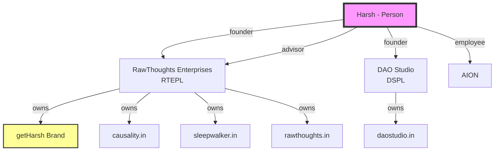
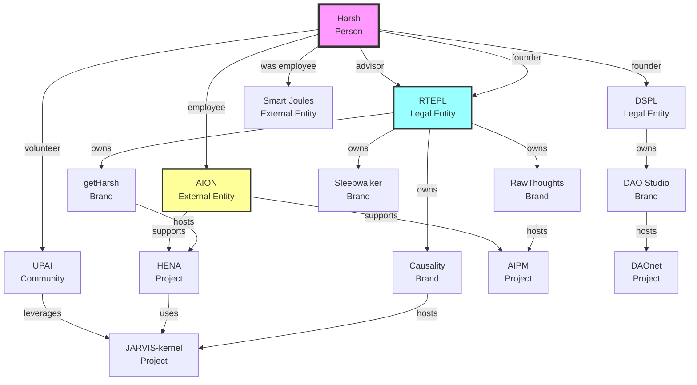

# Schema.org Entity Configuration Guide

## Table of Contents
1. [Ecosystem Philosophy](#ecosystem-philosophy)
2. [Quick Start](#quick-start)
3. [Entity Type Reference](#entity-type-reference)
4. [Entity Relationships](#entity-relationships)
5. [Brand Modeling](#brand-modeling)
6. [Configuration Examples](#configuration-examples)
7. [Page-Level Schemas](#page-level-schemas)
8. [Inheritance & Overrides](#inheritance--overrides)
9. [Implementation Guide](#implementation-guide)

## Ecosystem Philosophy

The getHarsh ecosystem represents a unique digital identity architecture where a person, brand, and ecosystem share the same name. This guide explains how to configure Schema.org entities to properly represent these relationships.

### Core Concept: Triple Identity

**getHarsh** represents three things simultaneously:
1. **Person**: Harsh (the individual human)
2. **Brand**: getHarsh (personal brand identity)
3. **Ecosystem**: The entire digital presence (all domains)

This creates a special case requiring careful Schema.org modeling.

### Ownership Structure



**Key Relationships**:
- RTEPL owns the getHarsh brand and most ecosystem domains
- DSPL is a separate legal entity, also founded by Harsh
- Harsh bridges both organizations
- Future potential for RTEPL ↔ DSPL partnerships

## Quick Start

### 1. Choose Your Entity Type

```yaml
# Person (like getHarsh)
schema_org_entity:
  type: "Person"
  additional_types: ["WebSite", "Brand"]

# Organization (like RTEPL, DSPL)
schema_org_entity:
  type: "Organization"
  additional_types: ["Corporation"]

# Research Project (like causality.in)
schema_org_entity:
  type: "ResearchProject"
  additional_types: ["CreativeWork", "WebSite"]

# Creative Work (like sleepwalker.in)
schema_org_entity:
  type: "CreativeWork"
  additional_types: ["VisualArtwork", "WebApplication"]
```

### 2. Configure Domain Aliases

```yaml
# Domain aliases become Schema.org sameAs URLs
domain_info:
  domain: "getHarsh.in"  # Primary domain
  domain_aliases:  # All other domains pointing to same content
    - "getharsh.com"
    - "getharsh.dev" 
    - "getharsh.online"

# For organization domains
domain_info:
  domain: "rawthoughts.in"
  domain_aliases:
    - "rtepl.co.in"  # Corporate domain
    - "rawthoughts.com"
    - "rawthoughts.enterprises"
```

### 3. Define Relationships

### Important Proto Message Updates

**Recent changes to proto definitions**:
- `SponsorSettings` in domain.proto is now `DomainSponsorSettings`
- `ProjectStatus` enum is now `ProjectDevelopmentStatus`
- Map fields cannot use enum types as keys - use strings for platform names and network names
- GTMConfig and ARIAConfig require fully qualified names when imported

```yaml
# Child claiming parent
parent_entity_id: "https://rawthoughts.in/#organization"
parent_relationship: "ownedBy"

# Parent listing children
children:
  - id: "https://getharsh.in"
    relationship: "owns"
    type: "Brand"
```

### 4. Configure Sponsorship

```yaml
# Auto-generation from social accounts
social:
  github: "getHarsh"
  youtube: "getHarshOnline"

sponsor:
  payment_links:
    # These are auto-generated if not explicitly set:
    # github_sponsors: "https://github.com/sponsors/getHarsh"
    # youtube_membership: "https://youtube.com/@getHarshOnline/join"
    
    # Cryptocurrency support
    crypto:
      bitcoin: "bc1qxy2kgdygjrsqtzq2n0yrf2493p83kkfjhx0wlh"
      ethereum: "getharsh.eth"  # ENS domains supported
      solana: "7EFk3VrWeb3npjuDPK8qrhPbTx8fPRUKqJtJxX5SqgYZ"
```

### 5. Configure Page Schemas

```yaml
pages_schema:
  "/projects":
    type: "CollectionPage"
    additional_types: ["ItemList"]
  "/contact":
    type: "ContactPage"
```

## Entity Type Reference

### Common Entity Types

| Entity | Primary Type | Additional Types | Use Case |
|--------|--------------|------------------|----------|
| Person | `Person` | `["WebSite", "Brand"]` | Individual with personal brand |
| Company | `Organization` | `["Corporation"]` | Legal business entity |
| Research | `ResearchProject` | `["CreativeWork"]` | Research initiatives |
| Software | `SoftwareApplication` | `["WebApplication"]` | Applications/tools |
| Blog | `Blog` | `["Periodical"]` | Publication sites |
| Art Project | `CreativeWork` | `["VisualArtwork"]` | Creative works |

### Relationship Types

| Relationship | Direction | Example |
|--------------|-----------|---------|
| `owns` | Parent→Child | RTEPL owns getHarsh brand |
| `ownedBy` | Child→Parent | getHarsh owned by RTEPL |
| `founder` | Person→Org | Harsh founded RTEPL |
| `hasPart` | Parent→Child | Domain has blog |
| `isPartOf` | Child→Parent | Project part of domain |

Related: See [schema/ecosystem.proto](schema/ecosystem.proto) - SchemaOrgEntity message definition.

## Entity Relationships

### Comprehensive Relationship Model

The ecosystem supports complex entity-to-entity relationships through a flexible relationship system:



### Relationship Types Reference

| Relationship | Inverse | Use Case | Example |
|-------------|---------|----------|---------|
| `owns` | `ownedBy` | Legal ownership | RTEPL owns getHarsh brand |
| `founder` | `foundedBy` | Founding relationship | Harsh founded RTEPL |
| `employee` | `employer` | Employment | Harsh employee of AION |
| `advisor` | `advisee` | Advisory role | Harsh advises RTEPL |
| `member` | `hasMember` | Membership | Harsh member of UPAI |
| `supports` | `supportedBy` | External support | AION supports HENA |
| `hosts` | `hostedBy` | Brand hosts project | getHarsh hosts HENA |
| `uses` | `usedBy` | Project dependency | HENA uses JARVIS-kernel |
| `leverages` | `leveragedBy` | External usage | UPAI leverages JARVIS |
| `partner` | `partnerOf` | Partnership | Future: RTEPL ↔ DSPL |
| `funder` | `fundedBy` | Funding relationship | AION funds research |

### Configuring Relationships

#### In ecosystem-defaults.yml:
```yaml
# Entity relationships catalog
entity_relationships:
  # Person to Entity affiliations
  - from_key: "harsh"
    from_type: "person"
    to_key: "RTEPL"
    to_type: "legal_entity"
    type: FOUNDER
    description: "Founded RawThoughts Enterprises"
    start_date: "2019-01-01"
    is_current: true
    
  - from_key: "harsh"
    from_type: "person"
    to_key: "AION"
    to_type: "organization"
    type: EMPLOYEE
    role: "Founding Product Manager"
    description: "Building frontier AI products"
    start_date: "2024-01-01"
    is_current: true
    
  # Entity to Entity relationships
  - from_key: "RTEPL"
    from_type: "legal_entity"
    to_key: "getHarsh"
    to_type: "brand"
    type: OWNS
    description: "Legal ownership of brand"
    is_current: true
    
  # Project relationships
  - from_key: "HENA"
    from_type: "project"
    to_key: "JARVIS-kernel"
    to_type: "project"
    type: USES
    description: "Uses JARVIS-kernel for message routing"
    is_current: true
    
  # External support
  - from_key: "AION"
    from_type: "organization"
    to_key: "HENA"
    to_type: "project"
    type: SUPPORTS
    description: "Provides infrastructure and resources"
    start_date: "2024-06-01"
    is_current: true
```

### Complex Relationship Scenarios

#### 1. Multi-Role Person
```yaml
# Harsh has multiple roles with RTEPL
persons:
  harsh:
    affiliations:
      - organization_key: "RTEPL"
        role: "Founder & Advisor"
        type: FOUNDER
        start_date: "2019-01-01"
        is_primary: false
        is_legal_entity: true
        description: "Founded the company, now advises on strategy"
        is_current: true
```

#### 2. Project Evolution
```yaml
# JARVIS-kernel evolved from simple router to neural architecture
entity_relationships:
  - from_key: "JARVIS-kernel"
    from_type: "project"
    to_key: "HENA"
    to_type: "project"
    type: DEPENDENCY_OF
    description: "Evolved to support HENA's neural routing needs"
    metadata:
      evolution_stage: "pivot"
      original_purpose: "message_router"
      new_purpose: "neural_message_backbone"
```

#### 3. Community Relationships
```yaml
communities:
  UPAI:
    key: "UPAI"
    name: "UPAI"
    description: "AI community leveraging ecosystem projects"
    status: "forming"
    member_person_keys: ["harsh"]
    leverages_project_keys: ["JARVIS-kernel", "AIPM"]
    
entity_relationships:
  - from_key: "UPAI"
    from_type: "community"
    to_key: "JARVIS-kernel"
    to_type: "project"
    type: LEVERAGES
    description: "Community uses JARVIS for collaboration"
```

## Brand Modeling

### Understanding Brands in the Ecosystem

Brands are **verticals** of legal entities that:
1. Group related projects under a common identity
2. Represent a specific focus area or philosophy
3. Can have special characteristics (personal brand, entity website)

### Brand Hierarchy

```
Legal Entity (RTEPL)
    ├── Brand: getHarsh (Personal Brand)
    │   ├── Project: getHarshMCP
    │   └── Project: getHarsh engine
    ├── Brand: Causality (Research)
    │   ├── Project: HENA
    │   └── Project: JARVIS-kernel
    ├── Brand: RawThoughts (Entity + Consulting)
    │   ├── Project: AIPM
    │   ├── Project: jarvisMCP
    │   └── Project: rteplMCP
    └── Brand: Sleepwalker (Creative)
        └── Projects: (future)
```

### Brand Configuration

```yaml
# In ecosystem-defaults.yml
brands:
  getHarsh:
    key: "getHarsh"
    name: "getHarsh"
    description: "Personal brand of Harsh Joshi - digital consciousness explorer"
    legal_entity_key: "RTEPL"
    domain_keys: ["getHarsh.in"]
    is_personal_brand: true
    schema_org:
      type: "Brand"
      additional_types: ["Person", "WebSite"]
      
  causality:
    key: "causality"
    name: "Causality"
    description: "Lifelong research into causality and time"
    legal_entity_key: "RTEPL"
    domain_keys: ["causality.in"]
    schema_org:
      type: "Brand"
      additional_types: ["ResearchOrganization"]
      
  rawThoughts:
    key: "rawThoughts"
    name: "RawThoughts"
    description: "Entity website and consulting brand of RTEPL"
    legal_entity_key: "RTEPL"
    domain_keys: ["rawThoughts.in"]
    # Special: This brand also serves as entity website
    is_entity_website: true
    schema_org:
      type: "Brand"
      additional_types: ["Organization", "ConsultingService"]
```

### Special Brand Types

#### 1. Personal Brand (getHarsh)
- Represents an individual person
- Social accounts are "sameAs" the person
- /contact connects to the person
- /about describes the person

#### 2. Entity Website Brand (rawThoughts, daostudio)
- Dual nature: brand AND entity website
- /contact connects to the legal entity
- /about describes the legal entity
- Offers services (consulting, etc.)

#### 3. Research/Creative Brands
- Focus on specific domains
- Host related projects
- Build communities around topics

### Brand-Project Relationships

Projects inherit their brand's:
- Visual identity (colors, themes)
- Legal ownership (via entity)
- Default policies
- Contact information (unless overridden)

Projects can override:
- Contact details (project-specific)
- Sponsorship (project-specific funding)
- Schema type (SoftwareApplication vs ResearchProject)

## Configuration Examples

### Example 1: getHarsh.in (Person + Brand + Ecosystem Hub)

```yaml
# In getHarsh.in/config.yml
schema_org_entity:
  type: "Person"
  additional_types: ["WebSite", "Brand"]
  custom_properties:
    name: "Harsh"
    alternateName: "getHarsh"
    brand: "getHarsh - Personal Brand & Ecosystem"
    description: "Digital consciousness explorer, ecosystem architect, and serial founder"
    knowsAbout: "AI, System Architecture, Digital Transformation, Philosophy, Blockchain"
    worksFor: "AION"
    jobTitle: "Digital Consciousness Explorer"
    # Multiple affiliations
    affiliation:
      - "@type": "Organization"
        name: "RawThoughts Enterprises Private Limited"
        role: "Founder"
      - "@type": "Organization"
        name: "DAO Studio Private Limited"
        role: "Founder"
      - "@type": "Organization"
        name: "AION"
        role: "Employee"
    advises: "RawThoughts Enterprises Private Limited"
  parent_entity_id: "https://rawthoughts.in/#organization"
  parent_relationship: "ownedBy"
  children:
    - id: "https://blog.getharsh.in"
      relationship: "hasPart"
      type: "Blog"

pages_schema:
  "/projects":
    type: "CollectionPage"
    additional_types: ["ItemList"]
    custom_properties:
      name: "getHarsh Projects Portfolio"
      description: "Personal projects and experiments"
      mainEntity: "https://getharsh.in/#person"
```

### Example 2: rawThoughts.in (Parent Organization)

```yaml
# In rawthoughts.in/config.yml
schema_org_entity:
  type: "Organization"
  additional_types: ["Corporation"]
  custom_properties:
    legalName: "RawThoughts Enterprises Private Limited"
    alternateName: "RTEPL"
    foundingDate: "2019-01-01"
    founder: "https://getharsh.in/#person"
    description: "Parent company of the getHarsh ecosystem"
    industry: "Technology, AI Research, Digital Innovation"
  # No parent_entity_id - this is the top-level org
  children:
    - id: "https://getharsh.in"
      relationship: "owns"
      type: "Brand"
    - id: "https://causality.in"
      relationship: "owns"
      type: "ResearchProject"
    - id: "https://sleepwalker.in"
      relationship: "owns"
      type: "CreativeWork"
```

### Example 3: Project with Custom Contact

```yaml
# In causality.in/PROJECTS/HENA/config.yml (ProjectOverrides)
schema_org_override:
  type: "SoftwareApplication"
  additional_types: ["ResearchProject"]
  custom_properties:
    applicationCategory: "Research Software"
    about: "Hybrid Engine for Neural Architecture"
    license: "Apache-2.0"
  parent_entity_id: "https://causality.in"
  parent_relationship: "isPartOf"

# Project-specific page overrides
pages_schema_override:
  "/contact":
    type: "ContactPage"
    custom_properties:
      about: "https://causality.in/PROJECTS/HENA"
      email: "hena-support@causality.in"
  "/sponsor":
    type: "WebPage"
    additional_types: ["DonateAction"]
    custom_properties:
      recipient: "https://causality.in/PROJECTS/HENA"
      # Different sponsorship for this project
```

### Example 4: Community Entity (UPAI)

```yaml
# In ecosystem-defaults.yml
communities:
  UPAI:
    key: "UPAI"
    name: "Universal Personal AI"
    description: "Community building personal AI assistants"
    status: "forming"  # "active", "forming", "inactive"
    website: "https://upai.org"
    member_person_keys: ["harsh"]
    leverages_project_keys: ["JARVIS-kernel", "AIPM"]
    schema_org:
      type: "Organization"
      additional_types: ["Consortium", "ResearchOrganization"]
      custom_properties:
        foundingDate: "2024-01-01"
        member:
          - "@type": "Person"
            "@id": "https://getharsh.in/#person"
            name: "Harsh"
            role: "Volunteer"

# Relationships
entity_relationships:
  - from_key: "UPAI"
    from_type: "community"
    to_key: "JARVIS-kernel"
    to_type: "project"
    type: LEVERAGES
    description: "Uses JARVIS for AI agent communication"
    is_current: true
```

### Example 5: Complex Multi-Entity Project Support

```yaml
# HENA project supported by multiple entities
entity_relationships:
  # AION provides infrastructure
  - from_key: "AION"
    from_type: "organization"
    to_key: "HENA"
    to_type: "project"
    type: SUPPORTS
    description: "Provides cloud infrastructure and GPU resources"
    metadata:
      support_type: "infrastructure"
      value: "compute_resources"
    
  # RTEPL owns through brand
  - from_key: "causality"
    from_type: "brand"
    to_key: "HENA"
    to_type: "project"
    type: HOSTS
    description: "Hosts under causality.in domain"
    
  # UPAI community uses it
  - from_key: "UPAI"
    from_type: "community"
    to_key: "HENA"
    to_type: "project"
    type: LEVERAGES
    description: "Community experiments with HENA for AI research"
```

## Page-Level Schemas

### Universal Pages (All Entities)

| Page | Schema Type | Additional Types | Purpose |
|------|-------------|------------------|---------|
| `/` | `WebPage` | `["AboutPage"]` | Homepage |
| `/about` | `AboutPage` | - | About entity |
| `/contact` | `ContactPage` | - | Contact info |
| `/sponsor` | `WebPage` | `["DonateAction"]` | Sponsorship |
| `/projects` | `CollectionPage` | `["ItemList"]` | Portfolio |
| `/404` | `WebPage` | `["ErrorPage"]` | Error page |
| `/privacy` | `WebPage` | `["PrivacyPolicy"]` | Privacy policy |
| `/terms` | `WebPage` | `["TermsOfService"]` | Terms |

Related: See [schema/domain.proto](schema/domain.proto) - pages_schema field definition.

### Blog-Specific Pages

```yaml
pages_schema:
  "/":  # Blog homepage
    type: "CollectionPage"
    additional_types: ["Blog"]
    custom_properties:
      mainEntityOfPage: "true"
  
  "/articles/*":  # Article pages (pattern)
    type: "BlogPosting"
    additional_types: ["Article"]
    # Article metadata comes from frontmatter
```

### Project Documentation Pages

```yaml
pages_schema_override:
  "/docs":
    type: "CollectionPage"
    additional_types: ["TechArticle"]
    custom_properties:
      name: "Documentation"
      about: "{project_id}"
```

## Inheritance & Overrides

### Inheritance Chain

```
ecosystem-defaults.yml
    ↓ (base configuration)
domain/config.yml
    ↓ (domain overrides)
blog/config.yml OR project/config.yml
    ↓ (entity overrides)
frontmatter (for articles)
```

### Override Rules

1. **Entity Schema**
   - Blogs inherit domain's `schema_org_entity`
   - Projects can override with `schema_org_override`
   - Use `inherit_parent_policies: false` to break inheritance

2. **Page Schemas**
   - Blogs inherit domain's `pages_schema`
   - Projects override with `pages_schema_override`
   - More specific paths override general ones

3. **Contact/Sponsor Pages**
   - Default: Points to domain entity
   - Project override: Points to project entity
   - Enables project-specific contact/funding

Related: See [schema/project.proto](schema/project.proto) - ProjectOverrides message.

### Policy Inheritance

```yaml
# Domain level
policy_overrides:
  enabled_policies:
    privacy_policy: true
    refund_policy: false  # No commerce
  
# Project can further override
policy_override:
  enabled_policies:
    api_terms: true  # Add API-specific
  inherit_parent_policies: true
```

Related: See [schema/domain.proto](schema/domain.proto) - PolicyOverrides message definition.

## Advanced Entity Types

### Comic/Book Content (Sleepwalker Project)

```yaml
# For comic series configuration
content_metadata:
  comic_type: COMIC_TYPE_SERIES
  # Maps to Schema.org ComicSeries
  
# For individual issues
content_metadata:
  comic_type: COMIC_TYPE_ISSUE
  issue_number: 42
  # Maps to Schema.org ComicIssue

# For story arcs
content_metadata:
  comic_type: COMIC_TYPE_STORY
  story_arc: "The Awakening Saga"
  # Maps to Schema.org ComicStory

# For book structures
content_metadata:
  book_structure: BOOK_STRUCTURE_BOOK
  isbn: "978-1234567890"
  # Maps to Schema.org Book
  
# For chapters
content_metadata:
  book_structure: BOOK_STRUCTURE_CHAPTER
  chapter_number: 7
  # Maps to Schema.org Chapter
```

### Service Types (AI Transformation Services)

The services system uses a **separate configuration file** pattern for clean separation of concerns:

```yaml
# In domain config.yml - simple enablement
features:
  services_enabled: true  # Master switch for entire services subsystem

# In separate config_services.yml - full service configuration
enabled: true
nav_label: "Services"

# Entity-specific legal compliance
terms_url: "https://rawthoughts.in/terms"  # RTEPL terms
privacy_url: "https://rawthoughts.in/privacy"

# Main services page configuration
main_page:
  meta_title: "AI Transformation Services | RawThoughts"
  meta_description: "Transform your business with AI..."
  hero_title: "AI Transformation for the Digital Age"
  hero_subtitle: "Don't let AI disruption happen to you. Lead it."
  positioning_statement: "Just as SEO defined the 2000s..."
  
  # Evolution timeline (SEO → Mobile → Cloud → AI)
  timeline:
    eras:
      - period: "2000-2010"
        title: "SEO Era"
        description: "Google PageRank dominance"
        key_points: ["Keyword optimization", "Link building"]
        
      - period: "2025+"
        title: "AI Era"
        description: "Intelligence everywhere"
        key_points: ["LLM optimization", "Agent interfaces"]
        is_current: true

# Individual service offerings
services:
  - id: "ai-growth"
    title: "AI Transformation (Growth)"
    tagline: "Be Found in the AI Age"
    description: "Make your business discoverable by AI search..."
    icon: "search"
    schema_type: "TechnologyService"  # Schema.org mapping
    features:
      - "AI SEO optimization"
      - "Discovery file implementation (robots.txt, ai.txt, llms.txt)"
      - "TDM rights management"
    outcomes:
      - "Appear in AI search results"
      - "Control AI descriptions"
    primary_cta:
      text: "Book Consultation"
      action: "link"
      target: "/contact#appointment"
      event_name: "service_consultation_click"
    
  - id: "ai-interface"
    title: "AI Transformation (Interface)"
    tagline: "Build Intelligent Experiences"
    description: "Create dynamic, context-aware experiences..."
    schema_type: "TechnologyService"
    # ... more service details

# Industry-specific landing pages for SEO
industry_pages:
  - slug: "customer-support"
    meta_title: "AI for Customer Support | Transform Support with AI"
    meta_description: "Implement AI agents for 24/7 support..."
    hero_title: "Transform Customer Support with AI"
    hero_subtitle: "90% faster response times, 100% coverage"
    industry_schema_type: "CustomerService"  # Schema.org industry
    benefits:
      - "24/7 intelligent support"
      - "Multi-language capabilities"
    service_ids: ["ai-interface", "ai-intelligence"]
    case_studies:
      - client: "TechCorp"
        challenge: "3-day response times"
        solution: "AI agent deployment"
        outcome: "90% faster responses"
        metrics: ["90% reduction", "85% resolution"]

# Blog integration for content-to-service conversion
blog_integration:
  enable_service_links: true
  default_cta_text: "Transform your {industry} with our AI solutions"
  link_style: "card"
  link_position: "after-intro"
  add_schema_markup: true

# Analytics configuration
analytics:
  primary_conversion_event: "service_consultation_booking"
  secondary_conversion_event: "service_quote_request"
  attribution_model: "data-driven"
  custom_dimensions:
    dimension1: "service_interest"
    dimension2: "industry_vertical"
```

#### Schema.org Service Mapping

The service system generates rich Schema.org structured data:

```json
{
  "@context": "https://schema.org",
  "@type": "ProfessionalService",
  "name": "AI Transformation Services",
  "provider": {
    "@type": "Organization",
    "name": "RawThoughts Enterprises Private Limited",
    "@id": "https://rawthoughts.in/#organization"
  },
  "serviceType": ["Consulting", "Technology", "Artificial Intelligence"],
  "areaServed": "Worldwide",
  "hasOfferCatalog": {
    "@type": "OfferCatalog",
    "name": "AI Services",
    "itemListElement": [
      {
        "@type": "Offer",
        "itemOffered": {
          "@type": "Service",
          "@id": "https://rawthoughts.in/services#ai-growth",
          "name": "AI Transformation (Growth)",
          "description": "Make your business discoverable by AI search engines",
          "provider": {"@id": "https://rawthoughts.in/#organization"}
        }
      }
    ]
  }
}
```

#### Entity-Specific Service Examples

Different entities offer different services based on their expertise:

```yaml
# getHarsh.in (Personal brand under RTEPL)
services:
  - id: "technical-advisory"
    title: "Technical Advisory"
    tagline: "Personal consulting from Harsh"
    schema_type: "ConsultingService"
    
# daostudio.in (DSPL entity)
services:
  - id: "dao-transformation"
    title: "DAO Transformation"
    tagline: "Decentralize your organization"
    schema_type: "ProfessionalService"
    
# causality.in (Research brand under RTEPL)
services:
  - id: "ai-research"
    title: "AI Research Services"
    tagline: "Academic-grade research"
    schema_type: "ResearchProject"
```

#### Key Configuration Features

1. **Separation of Concerns**: Services config separate from domain config
2. **Entity Awareness**: Each domain's services reflect its legal entity
3. **SEO-First Design**: Industry pages for targeted keywords
4. **Blog Integration**: Smart service CTAs in articles
5. **Complete Flexibility**: 1 service or 10, any configuration works
6. **Feature Flag Control**: `services_enabled: false` disables everything

### Project Development Status

```yaml
# In project config
project_info:
  name: "JARVIS-kernel"
  type: PROJECT_TYPE_FRAMEWORK
  status: PROJECT_STATUS_BETA  # Maps to "InProgress" in Schema.org
  # Available statuses:
  # PROJECT_STATUS_CONCEPT → "Incomplete"
  # PROJECT_STATUS_ALPHA → "Draft"
  # PROJECT_STATUS_BETA → "InProgress"
  # PROJECT_STATUS_STABLE → "Completed"
  # PROJECT_STATUS_DEPRECATED → "Discontinued"
  # PROJECT_STATUS_ARCHIVED → "Archived"
```

### License Types

```yaml
# In project config
project_info:
  license: LICENSE_TYPE_MIT
  # Maps to URL: https://opensource.org/licenses/MIT
  
# Available licenses:
# LICENSE_TYPE_MIT → MIT License URL
# LICENSE_TYPE_APACHE_2_0 → Apache 2.0 URL
# LICENSE_TYPE_GPL_3 → GPL 3.0 URL
# LICENSE_TYPE_PROPRIETARY → No URL (proprietary)
# LICENSE_TYPE_CC_BY_4_0 → Creative Commons Attribution 4.0 URL

# For content licensing
content_license: LICENSE_TYPE_CC_BY_4_0
# For code licensing
code_license: LICENSE_TYPE_MIT
```

### Audio Content Type

```yaml
# For Google Drive audio recordings
content:
  - type: CONTENT_TYPE_AUDIO_RECORDING
    title: "Podcast Episode: The Future of AI"
    media_url: "https://drive.google.com/file/d/..."
    duration: "PT45M"  # ISO 8601 duration
    # Maps to Schema.org AudioObject
```

### Software Schema Types

```yaml
# For project documentation
project_structured_data:
  software_application:
    application_category: "DeveloperApplication"
    operating_system: "Linux, macOS, Windows"
    software_version: "2.1.0"
    software_requirements: "Node.js 18+"
    # Maps to Schema.org SoftwareApplication
    
  dataset:
    distribution:
      - encoding_format: "CSV"
        content_url: "/data/training-set.csv"
      - encoding_format: "JSON"
        content_url: "/api/v1/data"
    # Maps to Schema.org Dataset
    
  course:
    course_mode: "online"
    course_workload: "PT5H"  # 5 hours per week
    # Maps to Schema.org Course
```

## Implementation Guide

### 1. Proto Schema References

All Schema.org configuration is defined in:
- **Base Types**: [schema/ecosystem.proto](schema/ecosystem.proto) - See SchemaOrgEntity section
- **Relationship Types**: [schema/ecosystem.proto](schema/ecosystem.proto) - See RelationshipType enum and EntityRelationship message
- **Brand Support**: [schema/ecosystem.proto](schema/ecosystem.proto) - See Brand message and brands catalog
- **Community Support**: [schema/ecosystem.proto](schema/ecosystem.proto) - See Community message and communities catalog
- **Domain Config**: [schema/domain.proto](schema/domain.proto) - See schema_org_entity field
- **Blog Overrides**: [schema/blog.proto](schema/blog.proto) - See BlogConfig message
- **Project Overrides**: [schema/project.proto](schema/project.proto) - See ProjectOverrides message
- **Project Relationships**: [schema/project.proto](schema/project.proto) - See ProjectRelationships message

### 2. Configuration Files

Implementation examples:
- **Ecosystem Defaults**: [ecosystem-defaults.yml](ecosystem-defaults.yml) - See default_schema_org_type
- **Domain Example**: [../getHarsh.in/config.yml](../getHarsh.in/config.yml) - See schema_org_entity section

### 3. Validation

Use the validation tools:
```bash
# Validate domain config
cd config/tools
./validate.sh ../../getHarsh.in/config.yml --env-file=../../.env

# Process with inheritance
./process-configs.sh --domain=getHarsh.in --mode=LOCAL
```

Related: See [tools/TOOLS.md](tools/TOOLS.md) for complete tool documentation.

### 4. Build Integration

The Gatsby theme engine will:
1. Read processed configs from `getHarsh/build/configs/`
2. Generate JSON-LD structured data
3. Inject into page `<head>` sections
4. Include in AI manifests

### 5. Best Practices

1. **Choose Specific Types**: Use the most specific Schema.org type
2. **Multiple Types**: Add relevant additional_types
3. **Valid Properties**: Only use properties valid for your type
4. **Test Locally**: Validate with Google's Structured Data Testing Tool
5. **Incremental Updates**: Start simple, add complexity gradually

## Key Insights

1. **getHarsh = Person + Brand + Ecosystem**: Unique triple identity
2. **Two Legal Entities**: RTEPL (owns most) + DSPL (separate)
3. **Harsh as Bridge**: Connects all entities through founder/advisor roles
4. **Flexible Types**: 816+ Schema.org types supported via strings
5. **Page-Level Control**: Every page can have specific schema
6. **Project Independence**: Projects can override contact/sponsor/schema
7. **Rich Relationships**: Entity-to-entity relationships with type safety
8. **Brand as Vertical**: Brands group projects under legal entities
9. **Community Support**: External communities can leverage projects
10. **Evolution Support**: Projects can emerge, scale, pivot, merge dynamically

## Related Documentation

- **Configuration Guide**: [CONFIG.md](CONFIG.md) - System architecture
- **Schema Reference**: [schema/SCHEMA.md](schema/SCHEMA.md) - Proto definitions
- **Tool Documentation**: [tools/TOOLS.md](tools/TOOLS.md) - Validation tools
- **Build Guide**: [GUARDRAILS.md](../../GUARDRAILS.md) - Ecosystem operations