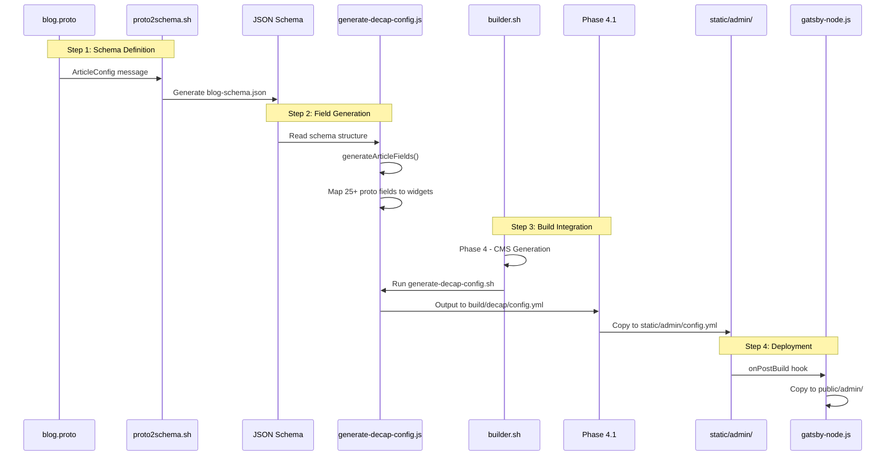
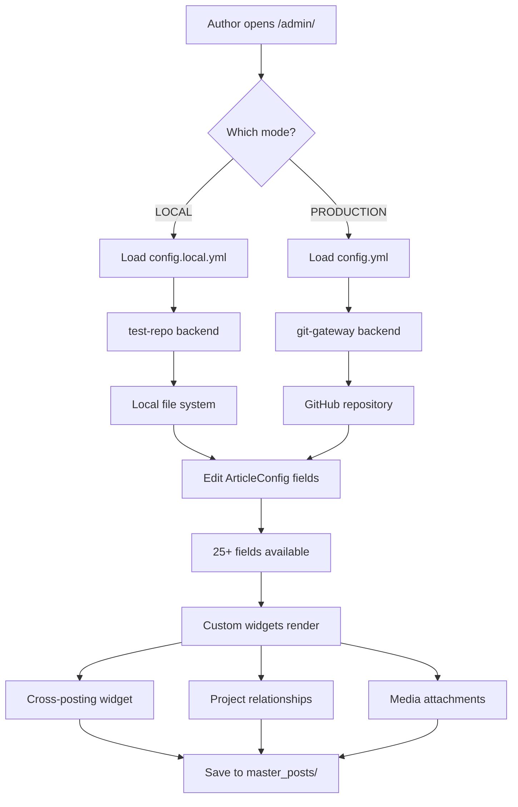
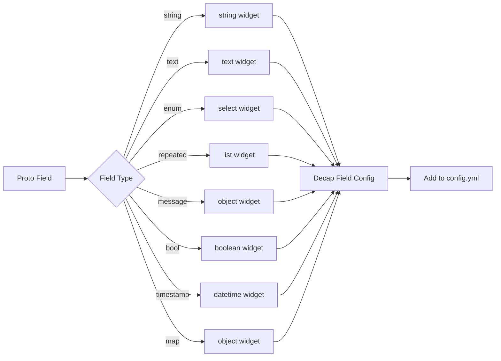

# CMS.md - Decap CMS Proto-Driven Configuration System

Proto-driven content management system that generates comprehensive Decap CMS configurations from 381 JSON schemas derived from 77+ protobuf definitions. Now with full TypeScript support, discovery-aware widgets, and 689 generated type definitions.

## 🚨 Critical Guardrails

### NEVER Do This
❌ **Edit config.yml directly** - It's auto-generated and will be overwritten  
❌ **Skip proto2schema.sh** - Proto schemas are the source of truth  
❌ **Mix LOCAL and PRODUCTION** - They use different backends  
❌ **Hardcode field options** - Everything from catalogs and discovery  
❌ **Bypass builder.sh** - It orchestrates the entire pipeline  

### ALWAYS Do This
✅ **Define fields in blog.proto first** - Proto is source of truth  
✅ **Run builder.sh for changes** - Never manual generation  
✅ **Test in LOCAL mode first** - Use test-repo backend  
✅ **Validate JSON schemas** - Catch errors early  
✅ **Check both config.yml AND config.local.yml** - Different for each mode  

## Proto-Driven Schema Integration

### Schema Pipeline
The CMS now leverages the complete proto-driven architecture:

```
77+ Protobuf Files → 381 JSON Schemas → 689 TypeScript Types → CMS Fields
```

### Key Enhancements
1. **Schema Loader** - Dynamically loads all 381 schemas at build time
2. **Type Generation** - Automatic TypeScript definitions from schemas
3. **Discovery Integration** - Real-time entity discovery (domains, blogs, projects)
4. **ProtoAwareWidget** - Base class for all custom widgets with schema validation
5. **Schema.org Mappings** - 300+ enum-to-Schema.org mappings for rich metadata

### Generated Assets
- `build/schemas/` - 381 JSON schemas from protos
- `build/types/` - 689 TypeScript definitions
- `build/discovery-manifest.json` - Real-time entity discovery
- `static/admin/widgets/` - 10 proto-aware custom widgets

## Architecture & Sequence

### Build-Time Generation Flow



### Runtime CMS Flow



## Proto Schema Deep Dive

### ArticleConfig Message ([blog.proto](../config/schema/blog.proto) - `ArticleConfig`)

```protobuf
message ArticleConfig {
  // Basic metadata
  string title = 1;                    // H1 title
  string slug = 2;                     // URL segment
  string summary = 3;                  // Meta description
  ContentType content_type = 4;        // Enum: tutorial, deep_dive, etc.
  bool is_draft = 5;                   // Publication status
  bool is_featured = 6;                // Homepage feature
  int32 reading_time_minutes = 7;      // Estimated read time
  
  // Authors & dates
  repeated string author_keys = 8;     // persons.yml references
  google.protobuf.Timestamp date_published = 9;
  google.protobuf.Timestamp date_modified = 10;
  
  // Cross-posting
  CrossPostingConfig cross_posting = 11;
  
  // Discussion & engagement
  repeated DiscussionUrl discussion_urls = 12;
  
  // Project relationships
  repeated string uses_project_keys = 13;
  repeated string updates_project_keys = 14;
  
  // Media & content
  MediaAttachments media = 15;
  repeated string keywords = 16;
  repeated string tags = 17;
  string body = 18;                    // Markdown content
  
  // SEO & schema
  string featured_image_url = 19;
  string canonical_url = 20;
  ArticleSchemaConfig article_schema = 21;
  
  // Display settings
  DisplaySettings display = 22;
  
  // Analytics
  string analytics_campaign = 23;
  map<string, string> utm_parameters = 24;
  
  // Version tracking
  int32 version = 25;
  string previous_version_url = 26;
  
  // Internal metadata
  google.protobuf.Timestamp created_at = 27;
  string created_by = 28;
  google.protobuf.Timestamp last_indexed = 29;
  repeated string internal_notes = 30;
  map<string, string> custom_metadata = 31;
}
```

## Field Mapping Pipeline

### Proto-to-Widget Transformation ([generate-decap-config.js](../config/tools/generate-decap-config.js))



### Key Mapping Functions

| Function | Purpose | Returns |
|----------|---------|----------|
| `generateArticleFields()` | Maps ArticleConfig to Decap fields | Field array |
| `generateAuthorOptions()` | Pulls from persons catalog | Author options |
| `generateDomainOptions()` | Pattern-based domain discovery | Domain list |
| `generateProjectOptions()` | Finds all projects dynamically | Project keys |
| `generateContentTypeOptions()` | Maps proto enums to selections | Content types |

## Custom Widget Implementation

### Cross-Posting Widget

Location: `src/static/admin/widgets/cross-posting-widget.tsx`

```typescript
// Widget provides:
// 1. Visual domain selection grid
// 2. Canonical domain picker
// 3. Cross-post date override
// 4. Import source selector
// 5. Preview of target blogs

interface CrossPostingWidgetProps {
  value: {
    canonical_domain: string
    published_domains: string[]
    show_cross_post_chips: boolean
    cross_post_date?: string
    import_source?: string
  }
  onChange: (value: any) => void
}
```

### Project Relationships Widget

Location: `src/static/admin/widgets/project-relationships-widget.tsx`

```typescript
// Widget provides:
// 1. Multi-select for "uses" projects
// 2. Multi-select for "updates" projects
// 3. Project preview cards
// 4. Automatic project discovery

interface ProjectRelationshipsWidgetProps {
  value: {
    uses_project_keys: string[]
    updates_project_keys: string[]
  }
  onChange: (value: any) => void
}
```

### Proto-Aware Custom Widgets

All widgets now extend `ProtoAwareWidget` base class for schema integration:

#### Core Widgets
- **MediaAttachmentsWidget** - Multi-tab interface for audio, video, code, diagrams
- **DiscussionPlatformsWidget** - 16 platform support with URL validation
- **SponsorWidget** - FTC compliance, affiliate tracking, tier management
- **SeriesWidget** - Progress tracking, navigation preview
- **SchemaOrgOverrideWidget** - JSON-LD preview, 10 schema types
- **FeatureOverridesWidget** - Grouped toggles with impact preview  
- **DisplaySettingsWidget** - Layout presets, live preview
- **CrossPostingWidget** - Discovery-aware domain selection
- **ProjectRelationshipsWidget** - Discovery-aware project linking

### Widget Registration ([cms.ts](../src/static/admin/cms.ts))

```javascript
// Register all proto-aware custom widgets
// These widgets leverage the 381 JSON schemas and discovery data
CMS.registerWidget("cross-posting", CrossPostingWidget)
CMS.registerWidget("project-relationships", ProjectRelationshipsWidget)
CMS.registerWidget("media-attachments", MediaAttachmentsWidget)
CMS.registerWidget("discussion-platforms", DiscussionPlatformsWidget)
CMS.registerWidget("sponsor", SponsorWidget)
CMS.registerWidget("series", SeriesWidget)
CMS.registerWidget("schema-org-override", SchemaOrgOverrideWidget)
CMS.registerWidget("feature-overrides", FeatureOverridesWidget)
CMS.registerWidget("display-settings", DisplaySettingsWidget)
```

## Mode Configuration

### LOCAL Mode Setup

```bash
# 1. Generate LOCAL config
./builder.sh --mode=LOCAL --domain=getHarsh.in

# 2. Check generated config
cat build/decap/config.yml | head -20
# Expected output:
# backend:
#   name: test-repo
#   branch: main

# 3. Verify static copy
ls -la src/static/admin/config*.yml
# Should show both config.yml and config.local.yml

# 4. Start dev server
cd src && npm run develop

# 5. Access CMS
# http://localhost:8000/admin/
```

### PRODUCTION Mode Setup

```bash
# 1. Generate PRODUCTION config
./builder.sh --mode=PRODUCTION --domain=getHarsh.in

# 2. Verify git-gateway backend
grep "backend:" build/decap/config.yml
# Expected: name: git-gateway

# 3. Check media paths
grep "media_folder:" build/decap/config.yml
# Expected: /static/uploads

# 4. Build site
cd src && npm run build

# 5. Verify deployment
ls -la public/admin/config.yml
```

## Troubleshooting Workflows

### Fields Not Appearing in CMS

```mermaid
flowchart TD
    Start[Field missing in CMS] --> Check1{Field in<br/>blog.proto?}
    Check1 -->|No| Fix1[Add to ArticleConfig message]
    Check1 -->|Yes| Check2{proto2schema.sh<br/>run?}
    Check2 -->|No| Fix2[Run ./proto2schema.sh]
    Check2 -->|Yes| Check3{JSON schema<br/>has field?}
    Check3 -->|No| Debug1[Check proto2schema.sh logs]
    Check3 -->|Yes| Check4{generate-decap-config.js<br/>maps field?}
    Check4 -->|No| Fix3[Add to generateArticleFields()]
    Check4 -->|Yes| Check5{builder.sh Phase 4<br/>completed?}
    Check5 -->|No| Fix4[Run ./builder.sh --mode=LOCAL]
    Check5 -->|Yes| Check6{config.yml<br/>updated?}
    Check6 -->|No| Fix5[Check Phase 4.1 copy step]
    Check6 -->|Yes| Fix6[Clear browser cache & reload]
```

### Custom Widget Not Loading

1. **Check widget registration**:
   ```bash
   grep "registerWidget" src/static/admin/cms.ts
   # Should show your widget registration
   ```

2. **Verify widget file exists**:
   ```bash
   ls -la src/static/admin/widgets/
   # Should list your widget files
   ```

3. **Check browser console**:
   ```javascript
   // Open /admin/ and check console for:
   // - Module not found errors
   // - Registration errors
   // - TypeScript compilation errors
   ```

4. **Verify field configuration**:
   ```yaml
   # In generated config.yml:
   - name: "cross_posting"
     label: "Cross-Posting Settings"
     widget: "cross-posting"  # Must match registration
   ```

### Git Gateway Authentication Issues

```bash
# 1. Check environment variables
grep "GATSBY_GITHUB_TOKEN\|GATSBY_NETLIFY_SITE_ID" .env

# 2. Verify Identity service
# In Netlify dashboard:
# Settings → Identity → Enable Git Gateway

# 3. Test authentication
curl -H "Authorization: Bearer $GATSBY_GITHUB_TOKEN" \
     https://api.github.com/user
# Should return user info

# 4. Check config backend
grep -A3 "backend:" src/static/admin/config.yml
# For PRODUCTION should show:
# backend:
#   name: git-gateway
#   branch: main
```

## Maintenance Procedures

### Adding a New Field to Articles

```bash
# 1. Edit proto schema
vim config/schema/blog.proto
# Add to ArticleConfig message:
# string new_field = 32;  // Your field description

# 2. Regenerate schemas
cd config/tools
./proto2schema.sh

# 3. Verify JSON schema
jq '.properties.new_field' build/schemas/blog-schema.json

# 4. Update field generator
vim generate-decap-config.js
# Add to generateArticleFields():
# {
#   name: "new_field",
#   label: "New Field",
#   widget: "string",
#   required: false
# }

# 5. Rebuild configuration
cd ../..
./builder.sh --mode=LOCAL --domain=[domain]

# 6. Verify in CMS
# Visit http://localhost:8000/admin/
# Create new post and check for field
```

### Creating a New Custom Widget

```bash
# 1. Create widget file
cat > src/static/admin/widgets/my-widget.tsx << 'EOF'
import * as React from 'react'

export const MyWidget = ({ value, onChange, field }) => {
  return (
    <div className="my-widget">
      <input 
        value={value || ''} 
        onChange={(e) => onChange(e.target.value)}
      />
    </div>
  )
}
EOF

# 2. Register widget
echo 'CMS.registerWidget("my-widget", MyWidget)' >> src/static/admin/cms.ts

# 3. Add to field configuration
# In generate-decap-config.js:
# {
#   name: "my_field",
#   widget: "my-widget"
# }

# 4. Rebuild and test
./builder.sh --mode=LOCAL
cd src && npm run develop
```

### Debugging Field Values

```bash
# 1. Check raw markdown files
cat master_posts/posts/2024-*.md | head -50
# Look for frontmatter fields

# 2. Verify field in config
grep -A2 '"field_name"' src/static/admin/config.yml

# 3. Check GraphQL availability
# Visit http://localhost:8000/___graphql
# Query:
# {
#   allMarkdownRemark {
#     nodes {
#       frontmatter {
#         field_name
#       }
#     }
#   }
# }

# 4. Console debugging in widget
# Add to widget component:
console.log('Widget value:', value)
console.log('Field config:', field)
```

## Cross-References

### Configuration Files
- [blog.proto](../config/schema/blog.proto) - `ArticleConfig` message
- [ecosystem-defaults.yml](../config/ecosystem-defaults.yml) - CMS default settings
- [persons.yml](../config/catalogs/persons.yml) - Author catalog
- [projects.yml](../config/catalogs/projects.yml) - Project catalog

### Processing Scripts
- [proto2schema.sh](../config/tools/proto2schema.sh) - Schema generation
- [generate-decap-config.js](../config/tools/generate-decap-config.js) - CMS config generator
- [builder.sh](../builder.sh) - Phase 4: CMS generation
- [process-configs.sh](../config/tools/process-configs.sh) - Config processing

### Implementation Files
- [gatsby-node.js](../gatsby-node.js) - `onPostBuild` hook for CMS
- [cms.ts](../src/static/admin/cms.ts) - Widget registration
- [cross-posting-widget.tsx](../src/static/admin/widgets/cross-posting-widget.tsx) - Cross-posting widget
- [project-relationships-widget.tsx](../src/static/admin/widgets/project-relationships-widget.tsx) - Project widget

### Documentation
- [BUILD.md](../BUILD.md) - Phase 4: Decap CMS configuration
- [USE-CASE.md](./USE-CASE.md) - CMS component requirements
- [SERVICES.md](./SERVICES.md) - Related services system
- [GUARDRAILS.md](../GUARDRAILS.md) - System guardrails

---

*Proto-driven CMS: 25+ fields, custom widgets, multi-domain support. Everything from schemas, nothing hardcoded.*