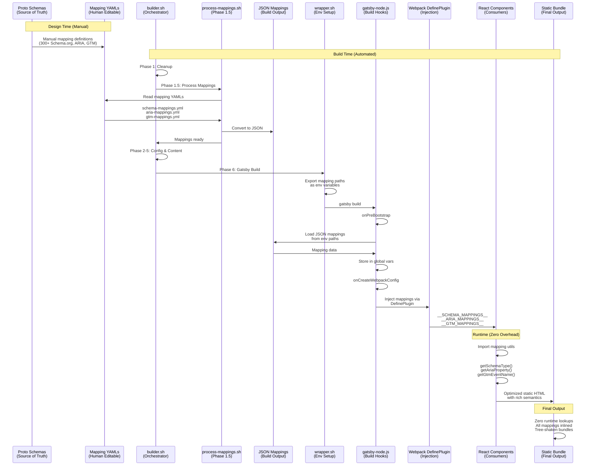

# Website Theme Engine

Multi-domain Gatsby theme engine with ecosystem integration, retrofuturistic design system, and Chakra-aligned color palettes.

## Overview

This is the centralized theme engine that powers all domain and blog sites in the ecosystem. It provides:

- 🎨 **5 Domain Themes** aligned with Chakra energy centers
- 🔧 **Build-time Configuration** via ecosystem environment variables
- 🎯 **Single Source of Truth** - all configuration comes from ecosystem
- ✨ **Retrofuturistic Design** with glass morphism and terminal aesthetics
- 🚀 **TypeScript** with full type safety
- 📦 **Component Library** using Radix UI + Tailwind CSS + shadcn/ui patterns
- 💼 **Services System** with Schema.org integration and conversion funnels
- 🔍 **Search System** with FlexSearch integration and cross-domain federation
- 🎯 **Three Core Subsystems**: Schema.org (SEO), ARIA (Accessibility), GTM (Analytics)
- 🔄 **Build-Time Mapping Integration**: Zero-runtime Proto → YAML → JSON → Component flow

## Ecosystem Integration

### Single Source of Truth
All configuration data comes from the ecosystem build process:
- Domain information from `config.yml` files
- Theme selection via environment variables
- No hardcoded values in components

### Environment Variables
The ecosystem wrapper (`wrapper.sh`) provides all configuration:
```bash
WEBSITE_DOMAIN          # Current domain (e.g., "getharsh.in")
WEBSITE_IS_BLOG        # "true" for blog sites
WEBSITE_MODE           # "LOCAL" or "PRODUCTION"
WEBSITE_THEME_ID       # Theme identifier
WEBSITE_ENTITY         # Legal entity name
WEBSITE_URL_*          # Various URLs
WEBSITE_SOCIAL_*       # Social media links
GATSBY_THEME_*_*       # Theme color values

# Project-specific (when building projects)
WEBSITE_IS_PROJECT     # "true" for project sites
WEBSITE_PROJECT_NAME   # Project name (e.g., "HENA")
WEBSITE_ENTITY_TYPE    # "domain", "blog", or "project"

# Services-specific (when services enabled)
WEBSITE_SERVICES_ENABLED  # "true" when services pages active
GATSBY_SERVICES_ENABLED   # Build-time flag for page generation

# Search-specific (enabled by default)
GATSBY_SEARCH_ENABLED     # Build-time flag for search features
```

### Build Process
```bash
# Always use ecosystem scripts - never run npm/gatsby directly!
# DO NOT use npm run commands - they bypass ecosystem configuration!

# Development (with hot reload)
../serve.sh --type=development --domain=getharsh.in         # Domain site
../serve.sh --type=development --domain=blog.getharsh.in    # Blog site
../serve.sh --type=development --domain=causality.in/PROJECTS/HENA  # Project site

# Full Production Build (all phases)
../builder.sh --mode=PRODUCTION --domain=getharsh.in        # Complete pipeline
../builder.sh --mode=PRODUCTION --domain=all                # Build all domains

# Individual Build Steps
../build.sh --domain=getharsh.in --mode=PRODUCTION         # Just Gatsby build
../build.sh --domain=blog.getharsh.in --mode=LOCAL         # Local testing

# Serve Pre-built Sites
../serve.sh --type=static --domain=getharsh.in --mode=PRODUCTION  # Serve production
../serve.sh --type=static --domain=getharsh.in --mode=LOCAL       # Serve local

# Direct Wrapper Usage (for advanced cases)
../wrapper.sh develop getharsh.in false LOCAL      # Domain dev server
../wrapper.sh build blog.getharsh.in true LOCAL    # Blog build
../wrapper.sh build causality.in/PROJECTS/HENA false PRODUCTION  # Project build
```

**IMPORTANT**: The npm scripts in package.json (`npm run develop`, `npm run build`) are **NOT** integrated with the ecosystem and should **NOT** be used. They bypass all configuration processing, theme injection, and environment setup.

For the complete build pipeline including all phases, see **[BUILD.md](../BUILD.md)**.

### Build-Time Mapping Integration Flow

The src directory transforms into the final output through a sophisticated build pipeline that processes Proto schemas → YAML configurations → JSON mappings → Component consumption:



### Mapping Integration Architecture

The build pipeline ensures zero-runtime overhead by resolving all mappings at build time:

1. **Proto Schemas** (config/schema/*.proto)
   - Define enums and structures
   - Source of truth for all types
   - 77 proto files with comprehensive definitions

2. **Mapping YAMLs** (config/schema/*-mappings.yml)
   - Human-editable enum → value mappings
   - Schema.org: 300+ type mappings
   - ARIA: Patterns, roles, and properties
   - GTM: Events, conversions, and parameters

3. **Build-Time Processing** (Phase 1.5)
   - `process-mappings.sh` converts YAML → JSON
   - Processed ONCE for entire ecosystem
   - Output to `build/mappings/` (global resources)

4. **Gatsby Integration** (Phase 6)
   - `gatsby-node.js` loads JSON in onPreBootstrap
   - Webpack DefinePlugin injects as constants
   - Available globally with zero runtime cost

5. **Component Consumption**
   - Import utilities from `@/utils/mappings`
   - Type-safe accessors with memoization
   - Automatic tree-shaking of unused mappings

## NPM Scripts Warning

The package.json scripts are **intentionally disabled** to enforce ecosystem integration:
- `npm run develop` → Shows error, use `../serve.sh --type=development`
- `npm run build` → Shows error, use `../builder.sh`
- `npm run serve` → Shows error, use `../serve.sh --type=static`
- `npm run clean` → Shows error, use `../clean.sh`

Internal scripts (`_internal_*`) are used by wrapper.sh only.

## Architecture

### Component Stack
- **[Radix UI](https://www.radix-ui.com/)** - Unstyled, accessible component primitives
- **[Tailwind CSS](https://tailwindcss.com/)** - Utility-first CSS framework  
- **[Class Variance Authority](https://cva.style/)** - Type-safe component variants
- **[shadcn/ui](https://ui.shadcn.com/)** - Copy-paste component patterns

### Design System

#### Theme System
Build-time theme injection based on domain configuration:

1. **Theme Selection**: Environment determines active theme
2. **CSS Variables**: Injected at runtime in `gatsby-browser.js`
3. **Tailwind Mapping**: CSS vars mapped to utility classes
4. **Component Usage**: Components use semantic color tokens

#### Retrofuturistic Design
- **Glass Morphism**: Blur effects with Safari/iOS support
- **Cascading Depth**: 5-level depth system (depth-0 to depth-4)
- **Terminal Typography**: JetBrains Mono + Fira Code
- **Soft Glow Borders**: Using `color-mix()` for dynamic effects
- **Premium Animations**: Fade-in, slide-in with GPU acceleration
- **Noise Texture**: Subtle overlay for premium finish

#### Domain Themes
Each domain aligns with a Chakra energy center:

| Domain | Chakra | Energy Center | Colors |
|--------|--------|---------------|---------|
| getHarsh | Manipura | Solar Plexus | Gold/Amber |
| rawThoughts | Muladhara + Svadhisthana | Root + Sacral | Terra/Rose |
| daoStudio | Anahata | Heart | Sage/Mint |
| causality | Vishuddha | Throat | Sky/Blue |
| sleepwalker | Sahasrara | Crown | Violet/Lavender |

### Component Development

#### Creating Components
Follow the shadcn/ui pattern:
1. Create component with Radix UI primitive
2. Style with Tailwind utilities
3. Add variants with CVA
4. Export with proper TypeScript types

Example:
```tsx
import { cva, type VariantProps } from "class-variance-authority"
import { cn } from "@/lib/utils"

const buttonVariants = cva(
  "btn inline-flex items-center justify-center",
  {
    variants: {
      variant: {
        default: "",
        primary: "!bg-accent-primary",
      },
    },
  }
)

export const Button = ({ className, variant, ...props }) => (
  <button className={cn(buttonVariants({ variant }), className)} {...props} />
)
```

#### Using Design System Classes
```tsx
// Depth system for layering
<Card variant="glass" depth={1}>Content</Card>

// Premium button with soft glow
<Button className="btn">Click Me</Button>

// Terminal-style elements
<div className="card-terminal">Terminal Content</div>
```

#### Component Organization
All components are located in `src/src/components/` following these conventions:
- **Naming**: All component files use **PascalCase** (e.g., `Button.tsx`, `ServiceCard.tsx`)
- **Imports**: Use the `@/` alias which maps to `src/src/` (e.g., `import { Button } from "@/components/ui/Button"`)
- **Barrel Exports**: Each component directory may have an `index.ts` for grouped exports
- **Separation**: Decap CMS admin components are in `static/admin/` - completely separate from main site components

### Cross-Domain Navigation

The theme system provides helpers for cross-domain links:

```tsx
import { buildCrossDomainLink } from "@/config/themes"

// From blog to domain
<a href={buildCrossDomainLink("/", false)}>Visit Main Site</a>

// From domain to blog  
<a href={buildCrossDomainLink("/", true)}>Read Blog</a>
```

## Directory Structure

```
src/                    # Gatsby project root (package.json, gatsby-config.ts)
├── src/                # Gatsby source directory (standard structure)
│   ├── components/     # React components (ALL use PascalCase naming)
│   │   ├── article/    # Article-specific components
│   │   ├── consent/    # GDPR consent components
│   │   ├── content/    # Content display components
│   │   ├── hero/       # Hero section components
│   │   ├── layout/     # Layout wrapper components
│   │   ├── navigation/ # Navigation components
│   │   ├── project/    # Project display components
│   │   ├── search/     # Search system components
│   │   ├── services/   # Services page components
│   │   ├── social/     # Social integration components
│   │   └── ui/         # Base UI components (Button, Card, etc.)
│   ├── config/         # Configuration and theme loading
│   ├── hooks/          # React hooks for three core subsystems
│   │   ├── search/     # Search-specific hooks
│   │   │   ├── useFlexSearch.ts    # FlexSearch integration
│   │   │   ├── useFederation.ts    # Cross-domain search
│   │   │   ├── useSearchFilters.ts # Filter management
│   │   │   ├── useSearchHotkeys.ts # Keyboard shortcuts
│   │   │   ├── useSearchIndex.ts   # Index management
│   │   │   └── useSearchTracking.ts # Search analytics
│   │   ├── useSchema.ts  # Schema.org builders and JSON-LD rendering
│   │   ├── useGTM.ts     # GTM event tracking (consent-aware)
│   │   ├── useAccessibility.ts  # ARIA and WCAG 2.1 AA features
│   │   ├── useConfig.ts  # Configuration access via GraphQL
│   │   └── useServiceTracking.ts # Service-specific conversions
│   ├── lib/            # Utilities and helpers
│   │   └── utils.ts    # Class merging (cn) and cross-domain URL builder
│   ├── utils/          # Additional utilities
│   │   ├── aria-helpers.ts  # ARIA and semantic HTML utilities
│   │   ├── gtm-services.ts  # GTM service conversion tracking
│   │   └── mappings.ts      # Build-time mapping accessors
│   ├── types/          # TypeScript type definitions
│   │   └── mappings.d.ts    # Global mapping type declarations
│   ├── pages/          # Gatsby pages
│   ├── styles/         # Global styles
│   │   └── global.css  # Tailwind imports + design system
│   └── templates/      # Page templates
├── static/             # Static assets
│   └── admin/          # Decap CMS admin panel (separate from main components)
│       ├── templates/  # CMS preview templates
│       └── widgets/    # CMS custom widgets
├── gatsby-config.ts    # Gatsby configuration
├── gatsby-node.js      # Build-time page generation, TypeScript support, mapping injection
└── design-system-variables.css  # CSS custom properties
```

**IMPORTANT**: The Gatsby standard structure uses `src/src/` - the outer `src/` is the project root, the inner `src/` contains source code. All components follow **PascalCase** naming convention.

**Path Mapping**: The TypeScript `tsconfig.json` maps `@/*` to `src/src/*`, so imports like `@/hooks/useGTM` resolve to `src/src/hooks/useGTM.ts`.

## Hooks Architecture

The theme engine provides four primary hooks that manage different aspects of the application. For complete data flow architecture, see [CONFIG.md - Data Flow Architecture](../config/CONFIG.md#data-flow-architecture).

### Core Hooks

- **useConfig**: Central configuration access via GraphQL
- **useGTM**: Event tracking implementation (consent-aware)
- **useSchema**: Schema.org structured data builders
- **useAccessibility**: WCAG 2.1 AA runtime behaviors

Each hook has distinct data sources and responsibilities - configuration values flow through GraphQL, enum translations through Webpack constants, and runtime behaviors are provided directly by hooks. See the [detailed hook analysis](../config/CONFIG.md#hook-data-sources--responsibilities) for complete information.

## Development Workflow

1. **Start Development Server**
   ```bash
   cd /Users/getharsh/GitHub/Website/getHarsh
   ./wrapper.sh dev getharsh.in
   ```

2. **Make Changes**
   - Components hot-reload automatically
   - Theme changes require restart

3. **Test Other Domains**
   ```bash
   ./wrapper.sh dev causality.in
   ./wrapper.sh dev blog.rawthoughts.in
   ```

4. **Build for Production**
   ```bash
   ./build.sh domain getharsh.in
   ```

## Content Management

The theme engine integrates with Decap CMS for content management:

### CMS Integration
- **[CMS.md](./CMS.md)** - Comprehensive Decap CMS configuration documentation
- **Proto-Driven Fields** - 25+ fields from ArticleConfig proto schema
- **Custom Widgets** - Cross-posting and project relationship management
- **Dynamic Generation** - CMS config generated from proto schemas

### Component Requirements
For detailed component specifications and page requirements, see:
- **[USE-CASE.md](./USE-CASE.md)** - Complete component and page blueprints
- **Article Components** - Header, navigation, social sharing
- **Blog Components** - LATEST posts, index lists, category filters
- **Page Templates** - Home, blog, project, and policy pages

## Services System

The theme engine includes a comprehensive services system for any business offerings:

### Services Configuration
- **[SERVICES.md](./SERVICES.md)** - Complete services implementation documentation
- **Configuration-Driven** - All services defined in `config_services.yml`
- **Schema.org Integration** - Dynamic generation at build time, no hardcoding
- **Industry Pages** - Vertical-specific service offerings

### Services Components
Dynamic service components with conversion tracking:
- **ServiceCard** - Individual service display with Schema.org
- **ServiceGrid** - Adaptive grid layout (1-N services)
- **IndustryCards** - Industry-specific landing pages
- **ServiceCTA** - Blog integration with 3 variants
- **EvolutionTimeline** - Timeline-based service progression

### Conversion Funnel
All service CTAs redirect to unified `/contact/` endpoint:
- Quote forms → `/contact/?action=quote`
- Calendar booking → `/contact/?action=schedule`
- Consultation → `/contact/`
- GTM event tracking for conversion optimization

## Search System

The theme engine includes a powerful client-side search system with federation capabilities:

### Search Configuration
- **[SEARCH.md](./SEARCH.md)** - Complete search implementation documentation
- **Schema-Aware Indexing** - 300+ proto-to-Schema.org mappings for intelligent search
- **Build-Time Generation** - Indexes created during Phase 5.0 of build pipeline
- **Cross-Domain Federation** - Search across the entire ecosystem

### Search Components
High-performance search components with privacy integration:
- **SearchInterface** - Main dialog with Cmd+K keyboard shortcut
- **SearchResults** - Grouped results by content type
- **SearchFilters** - Multi-faceted filtering (domains, types, tags, dates)
- **FederatedSearch** - Cross-domain result aggregation
- **SearchHighlight** - Query term highlighting in results

### Search Features
Client-side search without server dependencies:
- Build-time index generation (< 100KB per domain)
- LocalStorage caching with 15-minute TTL
- Debounced input (300ms) for performance
- GTM analytics tracking for search optimization
- Privacy-conscious with consent integration

## Three Core Subsystems: Schema.org, ARIA, and GTM

The theme engine implements **three comprehensive subsystems** across all pages and components, providing SEO, accessibility, and analytics:

### 🎯 Subsystem 1: Schema.org (SEO & AI Understanding)
**Complete implementation across all pages and components** for rich snippets and semantic understanding.

#### Page-Level Implementation (100% Coverage)
Every page has appropriate Schema.org types with breadcrumbs:
- **HomePage** (index.tsx) - WebPage/Blog with variant detection
- **AboutPage** (about.tsx) - AboutPage with Organization entity
- **ContactPage** (contact.tsx) - ContactPage with ContactPoint
- **ServicePage** (services/index.tsx) - ServicePage with OfferCatalog
- **CollectionPage** (projects.tsx) - CollectionPage with SoftwareApplication items
- **SearchResultsPage** (search.tsx) - SearchResultsPage with SearchAction
- **WebPage** (sponsor.tsx, demo.tsx, 404.tsx) - Generic WebPage with context

#### Component-Level Implementation
- **SEO.tsx** - WebSite and Article schemas via useSchema hook
- **ArticleHeader.tsx** - Article/BlogPosting with author and sponsor
- **ProjectCard.tsx** - SoftwareApplication for all variants
- **ServiceCard.tsx** - Service/Offer schemas with dynamic types
- **Footer.tsx** - Organization with sameAs links
- **Navigation** - SiteNavigationElement schemas
- **Search** - SearchAction potentials

#### Dynamic Mapping Integration
All components now consume build-time mappings for zero-runtime overhead:

```typescript
// Before: Hardcoded Schema.org types
const schemaType = contentType === 'tutorial' ? 'HowToArticle' : 'Article'

// After: Dynamic mapping resolution
import { getSchemaType } from '@/utils/mappings'
const schemaType = getSchemaType('content_types', contentType, 'Article')
// CONTENT_TYPE_TUTORIAL → "HowToArticle" (from mappings)
```

#### useSchema Hook
```typescript
import { useSchema } from '@/hooks/useSchema'

const AboutPage = () => {
  const { getBaseSchema, buildOrganizationSchema, mergeSchemas, renderJsonLd } = useSchema()
  
  const pageSchema = React.useMemo(() => {
    const baseSchema = getBaseSchema()
    const orgSchema = buildOrganizationSchema({ name, description })
    return mergeSchemas(baseSchema, {
      '@type': 'AboutPage',
      mainEntity: orgSchema,
      breadcrumb: { /* ... */ }
    })
  }, [])
  
  return <>{renderJsonLd(pageSchema)}</>
}

// With content type mapping
const ArticlePage = ({ article }) => {
  const { buildArticleSchema, renderJsonLd } = useSchema()
  
  const schema = buildArticleSchema({
    title: article.title,
    contentType: article.content_type, // e.g., "CONTENT_TYPE_TUTORIAL"
    // Automatically resolves to "HowToArticle" via mappings
  })
  
  return <>{renderJsonLd(schema)}</>
}
```

### ♿ Subsystem 2: ARIA (Accessibility & Screen Readers)
**WCAG 2.1 AA compliance** with semantic HTML and ARIA attributes throughout.

#### Page-Level ARIA Implementation (100% Coverage)
Every page has proper ARIA landmarks and semantic structure:
- **role="main"** - Primary content areas
- **role="navigation"** - Navigation sections
- **role="search"** - Search interfaces
- **aria-label** - Descriptive labels for regions
- **aria-labelledby** - Section heading associations
- **Semantic HTML** - `<main>`, `<header>`, `<nav>`, `<article>`, `<section>`, `<aside>`

#### Component-Level ARIA
- **Skip Links** - useAccessibility hook for keyboard navigation
- **Focus Management** - Modal and dialog focus trapping
- **Live Regions** - aria-live for dynamic content updates
- **Expanded States** - aria-expanded for collapsible sections
- **Form Labels** - aria-describedby for validation messages
- **Screen Reader Announcements** - Status messages for interactions

#### useAccessibility Hook
```typescript
import { useAccessibility } from '@/hooks/useAccessibility'

const SearchInterface = () => {
  const { announce, trapFocus, getSkipLinks, addLandmark } = useAccessibility()
  
  const handleResults = (count) => {
    announce(`Found ${count} results`)
  }
  
  // Skip links now use ARIA mappings for labels
  const skipLinks = getSkipLinks('search') // Returns mapped labels
  
  return (
    <div role="search" aria-label="Site search">
      {/* Search implementation */}
    </div>
  )
}

// Landmark with mapped configuration
const Navigation = ({ navRef }) => {
  const { addLandmark } = useAccessibility()
  
  useEffect(() => {
    // Uses ARIA mappings for proper landmark config
    addLandmark(navRef.current, 'navigation', 'primary')
  }, [])
}
```

### 📊 Subsystem 3: GTM (Analytics & Conversion Tracking)
**Comprehensive tracking** with consent awareness and rich context.

#### Page-Level GTM Tracking (100% Coverage)
Automatic page view tracking with enhanced context:
- **gatsby-browser.js** - Universal page tracking on route changes
- **Page-specific tracking** - Custom parameters per page type
- **Site type detection** - Domain/blog/project differentiation
- **Error tracking** - 404 pages with referrer data
- **Consent-aware** - Only tracks with user permission

#### Component-Level GTM (55% Coverage)
Key interaction tracking across critical components:
- **CTASection** - All CTA clicks with position and destination
- **HeroSection** - View tracking and scroll depth
- **ArticleGrid** - Article impressions and clicks
- **ProjectCard** - Project interactions (card/github/demo)
- **ServiceCard** - Service engagement tracking
- **SearchInterface** - Query, results, and filter tracking
- **SocialShare/Links** - Social platform interactions
- **ThemeToggle** - User preference tracking

### Implementation Coverage Summary

| Subsystem | Page-Level | Component-Level | Overall |
|-----------|------------|-----------------|----------|
| **Schema.org** | 100% ✅ | 85% ✅ | 92% |
| **ARIA** | 100% ✅ | 75% ✅ | 87% |
| **GTM** | 100% ✅ | 55% ⚠️ | 77% |

**Key Achievement**: All three subsystems are now comprehensively implemented at the page level, with strong component coverage for critical user interactions. The build-time mapping integration ensures zero-runtime overhead while providing access to 300+ Schema.org mappings, comprehensive ARIA patterns, and entity-aware GTM configurations.

### Hook Architecture Benefits
**Why hooks for all three subsystems**:
- **Performance**: No React context overhead
- **Tree-shaking**: Components only import what they use
- **Type-safety**: Full TypeScript support with mapping types
- **Consent-aware**: Built-in permission checks
- **Testability**: Easy to mock in tests
- **Build-time Resolution**: Zero runtime mapping lookups
- **Configuration-driven**: Change YAML, not component code

#### useGTM Hook
```typescript
import { useGTM } from '@/hooks/useGTM'

const ServiceCard = ({ service }) => {
  const { trackServiceInteraction, trackConversion, isEnabled } = useGTM()
  
  const handleClick = () => {
    // Now uses GTM mappings for event names and entity params
    trackServiceInteraction(service.name, 'card_click', {
      service_category: service.category,
      service_id: service.id
    })
    // Event name and entity params automatically mapped
  }
  
  const handleCTA = () => {
    // Conversion tracking with mapping configuration
    trackConversion('service_inquiry', service.price, 'INR')
    // Uses conversion mappings for proper event structure
  }
}
```

### Additional Hooks

#### useServiceTracking Hook
```typescript
import { useServiceTracking } from '@/hooks/useServiceTracking'

const ServiceGrid = ({ services }) => {
  const { trackConsultation, trackQuoteForm, setupServiceListing } = useServiceTracking({
    pageType: 'main',
    serviceCategory: 'ai_transformation'
  })
  
  useEffect(() => {
    setupServiceListing(services)
  }, [services])
}
```

#### useConfig Hook
```typescript
import { useConfig } from '@/hooks/useConfig'

const Footer = () => {
  const config = useConfig()
  const { social, policies, domain_info } = config
  
  return (
    <footer>
      {/* Use config data for footer content */}
    </footer>
  )
}
```

### Utility Functions

#### Mapping Utilities (`utils/mappings.ts`)
Type-safe accessors for build-time injected mappings:
- `getSchemaType()` - Transform enums to Schema.org types
- `getAriaRole()` - Get ARIA role configurations
- `getAriaProperty()` - Access ARIA properties by context
- `getGtmEventName()` - Map events to GTM configurations
- `getGtmEntityParams()` - Entity-aware tracking parameters
- `transformWithSchema()` - Bulk object transformations

#### ARIA Helpers (`utils/aria-helpers.ts`)
- `isSemanticHTML()` - Validate semantic markup
- `validateARIA()` - Check ARIA usage
- `calculateContrastRatio()` - WCAG color contrast
- `getFocusableElements()` - Focus management
- `addKeyboardNavigation()` - Arrow key support

#### GTM Services Utilities
Centralized conversion tracking in `utils/gtm-services.ts`:
- `trackConsultationClick()` - Primary conversion tracking
- `trackQuoteSubmit()` - Quote form conversions
- `trackServiceInteraction()` - Micro-conversions
- `trackIndustryPageView()` - Industry vertical tracking
- `setupEnhancedEcommerce()` - Service listing analytics

### Integration Points

#### gatsby-browser.js
- Initializes Google Consent Mode v2
- Manages focus on route changes
- Loads analytics scripts after consent

#### gatsby-ssr.js
- Adds `lang="en"` attribute for screen readers
- Injects theme CSS variables
- No wrapper components (performance)

#### Layout Components
- Skip links already implemented inline
- Can use `SkipToContent` component for complex navigation
- Hooks available for tracking and announcements

### Best Practices
1. **Always use semantic HTML first** - `<nav>`, `<main>`, `<article>`
2. **Use mapping utilities** - Never hardcode Schema.org/ARIA/GTM values
3. **Track events with context** - Include domain, entity, page type
4. **Test with real screen readers** - NVDA, JAWS, VoiceOver
5. **Respect user consent** - Never track without permission
6. **Progressive enhancement** - Features work without JavaScript
7. **Configuration over code** - Update YAMLs for new mappings

## Mapping Integration Impact

### What Changed with Build-Time Mappings

The theme engine now leverages the full power of Proto/YAML definitions through build-time injection:

#### Before (Hardcoded)
- ~10 Schema.org types used (out of 300+ defined)
- Basic ARIA attributes without pattern support
- Simple GTM tracking without entity awareness
- Components contained hardcoded type mappings
- Changes required code modifications

#### After (Configuration-Driven)
- **300+ Schema.org mappings** available with zero runtime cost
- **ARIA pattern library** with contextual labeling
- **Entity-aware GTM** with conversion configurations
- **Type-safe accessors** with full TypeScript support
- **YAML-driven updates** - change mappings without touching code

### Performance Characteristics

```typescript
// Build-time cost
- Mapping processing: +2-3 seconds (Phase 1.5)
- Webpack injection: Negligible
- Bundle size: +~50KB (worth it for semantic richness)

// Runtime cost
- Mapping lookups: 0ms (compile-time constants)
- First access: ~0.1ms (property access)
- Memoized access: ~0.01ms
- No network requests or async operations
```

### Configuration Example

To add a new content type mapping:

```yaml
# config/schema/schema-mappings.yml
content_types:
  CONTENT_TYPE_CASE_STUDY: "Article"  # Add new mapping
  CONTENT_TYPE_WHITEPAPER: "ScholarlyArticle"
```

No component changes needed - the mapping is automatically available:

```typescript
// Component automatically uses new mapping
const schema = buildArticleSchema({
  contentType: 'CONTENT_TYPE_WHITEPAPER' // → "ScholarlyArticle"
})
```

## Resources

- [Build System](../BUILD.md) - Complete build pipeline and workflows
- [CMS Configuration](./CMS.md) - Decap CMS setup and field mapping
- [Services System](./SERVICES.md) - Services configuration and implementation
- [Search System](./SEARCH.md) - FlexSearch integration and federation
- [Component Blueprint](./USE-CASE.md) - Detailed component requirements
- [Mapping Configuration](../config/SCHEMA.md) - Proto schemas and mappings
- [Design System](./design-system.html) - Visual reference
- [Gatsby Documentation](https://www.gatsbyjs.com/docs/)
- [Radix UI Docs](https://www.radix-ui.com/docs/primitives/overview/introduction)
- [Tailwind CSS Docs](https://tailwindcss.com/docs)
- [shadcn/ui Components](https://ui.shadcn.com/docs/components/accordion)

---

*Part of the getHarsh Website Ecosystem - where consciousness meets code through configuration*