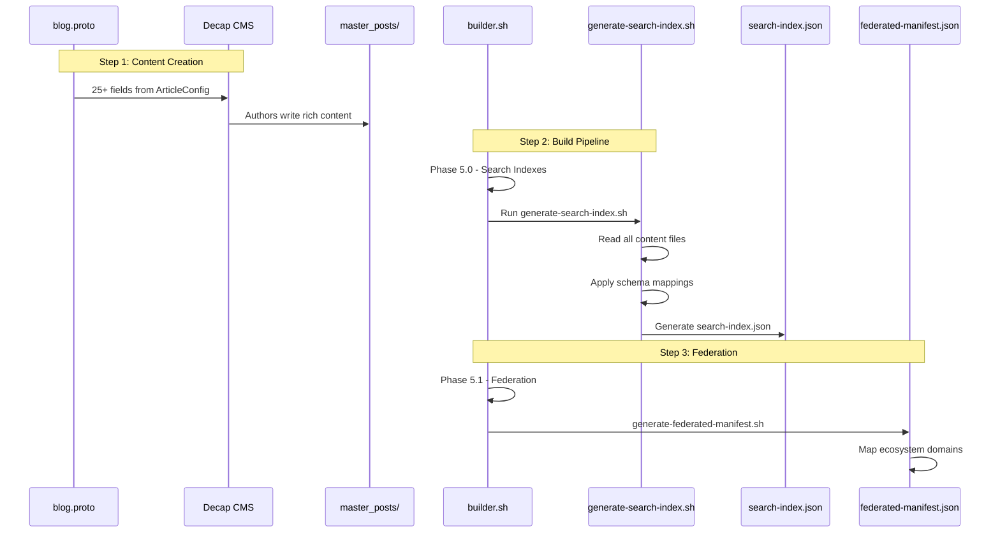
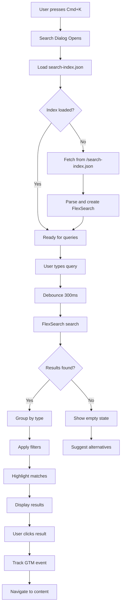
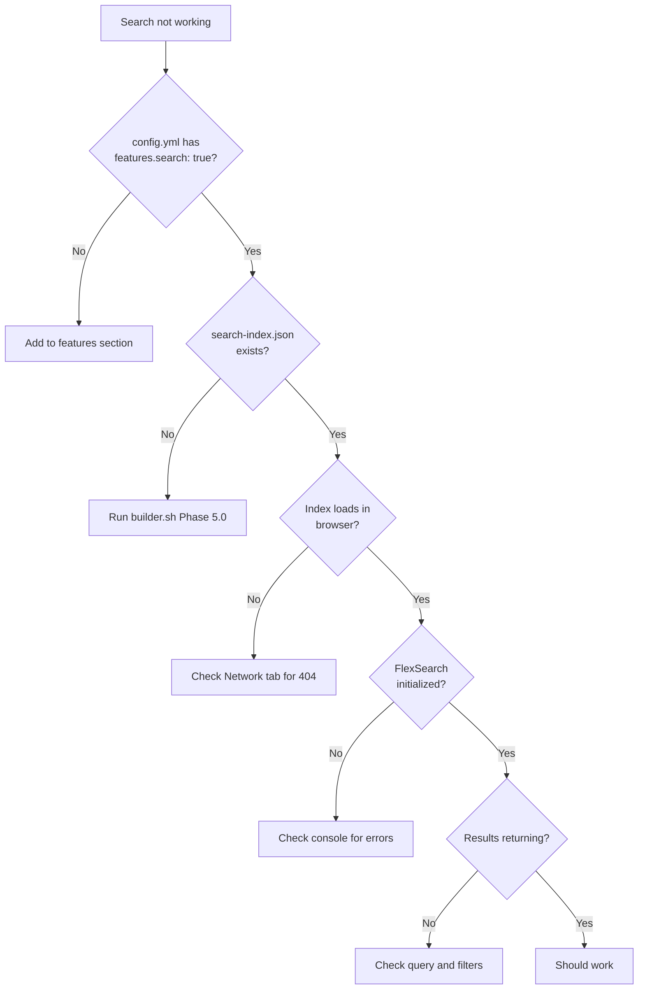
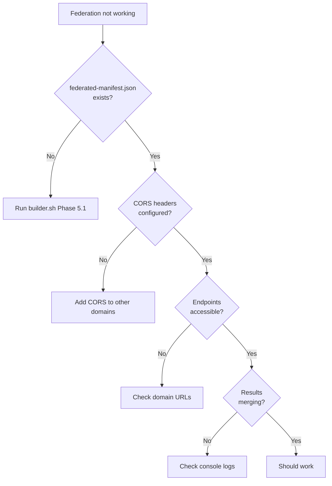

# SEARCH.md - FlexSearch Integration System

Schema-aware, privacy-conscious search across the getHarsh ecosystem - from local content discovery to cross-domain federation.

## 📊 Business Requirements

### User Needs
- **Fast, intuitive search** across all content types (< 50ms response)
- **Cross-domain discovery** of related content via federation
- **Privacy-conscious** search respecting user consent
- **Accessible** interface with keyboard navigation (WCAG 2.1 AA)
- **Mobile-optimized** search experience

### Success Metrics
- **Search usage**: > 20% of visitors use search
- **Success rate**: > 70% find what they're looking for
- **Click-through**: > 40% click on search results
- **Performance**: < 100KB index size per domain

## 🚨 Critical Guardrails

### NEVER Do This
❌ **Index content without consent check** - Respect privacy settings  
❌ **Hardcode domain lists** - Everything from ecosystem discovery  
❌ **Mix search indexes** - Each bundle has its own index  
❌ **Skip schema mappings** - Use 300+ proto-to-Schema.org mappings  
❌ **Create search.tsx in pages/** - Use /search route properly  
❌ **Query without debouncing** - Always debounce user input  

### ALWAYS Do This
✅ **Check search_enabled first** - Feature flag controls everything  
✅ **Generate at build time** - Indexes created during Phase 5.0  
✅ **Use schema mappings** - Leverage 300+ enum mappings  
✅ **Respect consent** - Check privacy settings before indexing  
✅ **Test federation** - Cross-domain search must work  
✅ **Handle empty results** - Graceful UI for no matches  

## Architecture & Sequence

> **Key Concept**: Search is a **build-time indexed, runtime queried** system. Indexes are generated during build (Phase 5.0) and loaded client-side for instant search without server calls.

### Build-Time Index Generation



### Runtime Search Flow



## Implementation Checklist

### 1. Install Dependencies (One-Time Setup)

#### Step 1.1: Install NPM Packages
```bash
cd /Users/getharsh/GitHub/Website/getHarsh/src
npm install
# This installs flexsearch and use-debounce already added to package.json
```

#### Step 1.2: Verify Installation
```bash
npm list flexsearch use-debounce
# Should show both packages installed
```

### 2. Enable Search (Configuration)

#### Step 2.1: Domain Configuration
In `[domain]/config.yml`:
```yaml
features:
  search: true  # Default is true
  ai_search_optimization:
    enabled: true
    index_path: "/search-index.json"
    federated_manifest_path: "/federated-manifest.json"
```

#### Step 2.2: Build Pipeline
Search indexes generate automatically when enabled:
```bash
./builder.sh --domain=[domain] --mode=LOCAL
# Phase 5.0: Generates search-index.json
# Phase 5.1: Generates federated-manifest.json (if federation enabled)
```

### 3. Component Structure

```
src/components/search/
├── SearchInterface.tsx      # Main search dialog (Cmd+K trigger)
├── SearchInput.tsx          # Debounced input with icon
├── SearchResults.tsx        # Result list with grouping
├── SearchResultItem.tsx     # Individual result with highlighting
├── SearchFilters.tsx        # Domain/type/date filters
├── SearchEmpty.tsx          # Empty state with suggestions
├── FederatedSearch.tsx      # Cross-domain result aggregation
├── SearchHighlight.tsx      # Text highlighting component
└── index.ts                # Barrel export
```

### 4. Hook Structure

```
src/hooks/search/
├── useFlexSearch.ts        # FlexSearch instance management
├── useSearchIndex.ts       # Index loading and caching
├── useSearchFilters.ts     # Filter state management
├── useSearchTracking.ts    # GTM analytics for search
├── useFederation.ts        # Cross-domain search
└── useSearchHotkeys.ts     # Keyboard shortcuts
```

## Configuration Deep Dive

### Search Configuration ([manifest.proto](../config/schema/manifest.proto))

```protobuf
message AISearchOptimization {
  bool enabled = 1;                           // Master switch
  string index_path = 2;                      // "/search-index.json"
  string federated_manifest_path = 3;         // "/federated-manifest.json"
  repeated string priority_content_types = 4; // Content to prioritize
  map<string, float> boost_factors = 5;       // Field boost values
  SearchUISettings ui_settings = 6;           // UI configuration
}

message SearchUISettings {
  bool show_filters = 1;           // Show filter sidebar
  bool show_suggestions = 2;        // Show search suggestions
  bool enable_fuzzy = 3;           // Fuzzy matching
  bool enable_highlighting = 4;    // Highlight matches
  int32 results_per_page = 5;     // Pagination
  bool group_by_type = 6;         // Group results
  int32 debounce_delay = 7;       // Debounce delay in ms
  bool enable_hotkeys = 8;        // Enable keyboard shortcuts
  bool enable_federation = 9;     // Show federation results
}
```

### FlexSearch Configuration

Entity-specific search presets are configured based on Schema.org type:

| Entity Type | Tokenization | Encoding | Use Case |
|-------------|--------------|----------|----------|
| `Person` | forward | extra | Names and personal content |
| `Organization` | reverse | icase | Company names and services |
| `ResearchProject` | full | extra | Technical documentation |

Configuration happens in:
- Build time: [`generate-search-index.js`](../config/tools/generate-search-index.js) - `createFlexSearchIndex()` function
- Runtime: [`useFlexSearch.ts`](../src/src/hooks/search/useFlexSearch.ts) - FlexSearch instance management

## Schema-Aware Tokenization

### Leveraging 300+ Proto-to-Schema.org Mappings

The search system uses proto-to-Schema.org mappings for intelligent tokenization:

| Content Type | Schema.org Type | Tokenization Strategy | Boost Factor |
|--------------|----------------|----------------------|-------------|
| `CONTENT_TYPE_TUTORIAL` | HowTo | Step-by-step focus, strict tokenization | 1.6 |
| `CONTENT_TYPE_RESEARCH` | ScholarlyArticle | Full text analysis, bidirectional context | 1.8 |
| `CONTENT_TYPE_OPINION` | Opinion | Forward tokenization, balanced encoding | 0.8 |
| `CONTENT_TYPE_TECHNICAL` | TechArticle | Advanced encoding, code-aware | 1.6 |
| `CONTENT_TYPE_NEWS` | NewsArticle | Recent content boost, quick scan | 1.4 |
| `CONTENT_TYPE_REVIEW` | Review | Rating and sentiment aware | 1.2 |

Mapping sources:
- Proto definitions: [`blog.proto`](../config/schema/blog.proto) - `ContentType` enum
- Schema mappings: [`schema-mappings.yml`](../config/schema/schema-mappings.yml) - `content_types` section
- Implementation: [`generate-search-index.js`](../config/tools/generate-search-index.js) - `createSchemaAwareConfig()` function

### Enhanced Multi-Index Architecture

The search system now supports multiple indexes for optimal performance:

#### Language-Specific Indexes
- Separate indexes per language (en, hi, etc.)
- Language-aware stemming and tokenization
- Automatic language detection from content

#### Type-Specific Indexes
- `unified` - All content with balanced settings
- `posts` - Blog posts with content-aware boosting
- `pages` - Marketing pages with WebPage schema
- `projects` - Project documentation with reverse tokenization

#### Specialized Indexes
- Created dynamically for common content type + language combinations
- Example: `en-HowTo`, `hi-BlogPosting`
- Only created when 5+ documents match criteria
- Optimized settings per Schema.org type

## UI Component Implementation

### SearchInterface Component (Main Dialog)

The main search dialog handles user interaction and result display.

**Location**: [`SearchInterface.tsx`](../src/src/components/search/SearchInterface.tsx)

**Key Features**:
- Debounced input (300ms)
- Keyboard shortcut (Cmd+K)
- Result grouping by type
- Federation support (optional)
- GTM event tracking

**Dependencies**:
- `@radix-ui/react-dialog` - Dialog primitive
- `use-debounce` - Input debouncing
- `flexsearch` - Search engine

**Hooks Used**:
- `useFlexSearch` - Search index management
- `useSearchFilters` - Filter state
- `useSearchTracking` - Analytics
- `useSearchHotkeys` - Keyboard shortcuts

### Search Result Grouping

Results are grouped by Schema.org type for better organization.

**Location**: [`SearchResults.tsx`](../src/src/components/search/SearchResults.tsx)

**Grouping Strategy**:

| Schema Type | Icon | Priority | Max Items |
|-------------|------|----------|----------|
| BlogPosting | 📝 | High | 5 |
| Person | 👤 | Medium | 3 |
| Project | 🚀 | Medium | 3 |
| Organization | 🏢 | Low | 2 |

**Components**:
- `SearchResultItem` - Individual result with highlighting
- `SearchHighlight` - Text highlighting for matches
- `SchemaIcon` - Type-specific icons

## Cross-Domain Federation

### Federation Manifest Structure

```json
{
  "version": "1.0",
  "currentDomain": {
    "domain": "getHarsh.in",
    "type": "Person",
    "searchEndpoint": "/search-index.json",
    "capabilities": {
      "filters": true,
      "fuzzy": true,
      "suggestions": true
    }
  },
  "federation": {
    "domains": [
      {
        "domain": "causality.in",
        "type": "ResearchProject",
        "relationship": "owned_by_RTEPL",
        "searchEndpoint": "https://causality.in/search-index.json"
      },
      {
        "domain": "blog.getHarsh.in",
        "type": "Blog",
        "relationship": "subdomain",
        "searchEndpoint": "https://blog.getHarsh.in/search-index.json"
      }
    ]
  }
}
```

### FederatedSearch Component

Enables searching across multiple domains in the ecosystem.

**Location**: [`FederatedSearch.tsx`](../src/src/components/search/FederatedSearch.tsx)

**Federation Strategy**:
1. Load federation manifest from `/federated-manifest.json`
2. Query each domain's search index (max 3 results per domain)
3. Merge and deduplicate results
4. Respect privacy settings across domains

**Manifest Generation**: [`generate-federated-manifest.js`](../config/tools/generate-federated-manifest.js)

## Privacy & Consent Integration

### Consent-Aware Indexing

Search respects user consent settings at both build and runtime.

**Build-Time Privacy** ([`generate-search-index.js`](../config/tools/generate-search-index.js) - `shouldIndexContent()`):
- Skip private/draft content
- Exclude noindex flagged items
- Respect sponsor content settings

**Runtime Privacy** (to be implemented in `useFlexSearch` hook):
- Check consent before loading index
- Filter results based on current consent
- Track only with analytics consent

## GTM Analytics Integration

### Search Event Tracking

**Location**: [`useSearchTracking.ts`](../src/src/hooks/search/useSearchTracking.ts)

**Events Tracked**:

| Event | Trigger | Data | Purpose |
|-------|---------|------|---------|  
| `search` | Query submitted | Term, result count | Query analysis |
| `search_result_click` | Result clicked | Position, type, URL | Relevance tracking |
| `search_filter` | Filter applied | Filter type, value | Usage patterns |
| `search_federation` | Cross-domain search | Source domain | Federation usage |

**Integration Point**: Uses `window.dataLayer` for GTM

## Troubleshooting Workflows

### Search Not Working



### Federation Not Working



## Performance Optimization

### Index Size Management

**Build-Time Optimization** ([`generate-search-index.js`](../config/tools/generate-search-index.js)):
| Strategy | Implementation | Impact |
|----------|---------------|--------|
| Selective indexing | Only index title, summary, keywords | -60% size |
| Field limiting | Store only display fields | -40% size |
| Compression | Remove special characters | -20% size |
| Token depth | Limit to 3 levels | Faster queries |
| Chunking | Split documents into 100-item chunks | Progressive loading |
| Multi-index | Separate indexes by type/language | Targeted queries |

### New Performance Features

#### Document Chunking
- Documents split into 100-item chunks (50 in LOCAL mode)
- Progressive loading for better initial performance
- Chunks loaded on-demand as user scrolls

#### Content-Based Boost Factors
- Featured content: 1.3x boost
- Recent content (< 30 days): 1.2x boost
- Recent content (< 90 days): 1.1x boost
- Schema type priorities (HowTo: 0.8, ScholarlyArticle: 0.9, etc.)

#### GraphQL Relationship Integration
- Cross-posting relationships preserved
- Project associations tracked
- Enables "Related content" features

### Lazy Loading Strategy

**Component Loading**:
1. Search dialog loads on-demand (React.lazy)
2. Index fetches on first search interaction
3. Manifest loads first, then chunks progressively
4. Language-specific indexes load based on user preference
5. Specialized indexes load on-demand
6. Cache index in localStorage (15min TTL)

## Enhanced Search Usage

### Basic Search with Multi-Index

```typescript
import { useSearchIndex } from '@/hooks/search/useSearchIndex'

export function SearchPage() {
  const { 
    search, 
    searchMultiIndex, 
    isReady,
    availableIndexes 
  } = useSearchIndex({
    useMultiIndex: true,
    preferredLanguage: 'en'
  })

  // Single index search
  const results = search('gatsby tutorial', { 
    index: 'posts',
    boost: true,
    limit: 20 
  })

  // Multi-index search
  const multiResults = searchMultiIndex('gatsby tutorial', {
    indexes: ['posts', 'pages', 'en-HowTo'],
    boost: true
  })
}
```

### URL Structure Awareness

The search system now correctly handles the multi-domain architecture:
- Blog posts: Only on `blog.domain.in/[slug]/`
- Marketing pages: On main domains `domain.in/[page]/`
- Projects: Separate subdomains with own search indexes

### Branch-Aware Search (Local Development)

For project repositories with dual-branch architecture:
- Content is indexed from `master_posts` (source of truth)
- In LOCAL mode, projects use `site` branch for output
- In PRODUCTION, everything is deployed without branch complexity

## Testing Guide

### 1. Quick Test

```bash
# Step 1: Install dependencies
cd /Users/getharsh/GitHub/Website/getHarsh/src
npm install

# Step 2: Start development server
cd ..
./wrapper.sh dev getharsh.in

# Step 3: Test search functionality
# - Navigate to http://localhost:8000/search
# - Press Cmd+K (Mac) or Ctrl+K (Windows/Linux)
# - Type a search query
# - Verify results appear
```

### 2. Build Test

```bash
# Step 1: Run full build pipeline
cd /Users/getharsh/GitHub/Website/getHarsh
./builder.sh --domain=getharsh.in --mode=LOCAL

# Step 2: Check for search index generation
ls -la build/sites/getharsh.in/search-index.json
# Should show the generated index file

# Step 3: Serve the built site
./serve.sh --type=static --domain=getharsh.in --mode=LOCAL

# Step 4: Test search on production build
# - Navigate to http://localhost:9000/search
# - Verify search works with production build
```

### 3. Troubleshooting NPM Issues

If you encounter TypeScript errors about missing modules:

```bash
# Clean and reinstall
cd /Users/getharsh/GitHub/Website/getHarsh/src
rm -rf node_modules package-lock.json
npm install

# Verify specific packages
npm list flexsearch use-debounce

# If still having issues, install explicitly
npm install flexsearch@0.7.31 use-debounce@10.0.0
```

## Maintenance Procedures

### Adding New Content Types

```bash
# 1. Update proto schema
vim config/schema/blog.proto
# Add new ContentType enum value

# 2. Regenerate schemas
./config/tools/proto2schema.sh

# 3. Update schema mappings
vim config/schema/schema-mappings.yml
# Add content_type mapping

# 4. Rebuild indexes
./builder.sh --domain=[domain] --mode=LOCAL

# 5. Test search
# Search for content with new type
```

### Updating Search Weights

```yaml
# In config.yml - ai_search_optimization.boost_factors
boost_factors:
  title: 2.0        # Title matches most important
  summary: 1.5      # Summary next
  content: 1.0      # Body content baseline
  keywords: 1.8     # Keywords highly weighted
  author: 0.5       # Author less important
```

## Future Enhancements

### Nice to Have (Post-MVP)

1. **Search Suggestions**
   - Auto-complete from popular searches
   - Recent searches per user
   - Trending topics

2. **Advanced Filters**
   - Date range picker
   - Author filter with avatars
   - Project relationship filters
   - Language filters

3. **Search Analytics Dashboard**
   - Popular search terms
   - No-result queries
   - Click-through rates
   - Search funnel analysis

4. **AI-Enhanced Search**
   - Semantic search using embeddings
   - Natural language queries
   - Answer extraction
   - Related content suggestions

## Cross-References

### Configuration Files
- [`manifest.proto`](../config/schema/manifest.proto) - `AISearchOptimization` message
- [`blog.proto`](../config/schema/blog.proto) - `ArticleConfig` with 25+ fields  
- [`schema-mappings.yml`](../config/schema/schema-mappings.yml) - 300+ proto-to-Schema.org mappings
- [`ecosystem-defaults.yml`](../config/ecosystem-defaults.yml) - Default `ai_search_optimization` settings

### Build-Time Scripts
- [`generate-search-index.sh`](../config/tools/generate-search-index.sh) - Shell wrapper for index generation
- [`generate-search-index.js`](../config/tools/generate-search-index.js) - Core index generation logic
- [`generate-federated-manifest.sh`](../config/tools/generate-federated-manifest.sh) - Shell wrapper for federation
- [`generate-federated-manifest.js`](../config/tools/generate-federated-manifest.js) - Federation manifest logic
- [`builder.sh`](../builder.sh) - Phase 5.0 (search) and 5.1 (federation) orchestration

### Implemented Components
- [`SearchInterface.tsx`](../src/src/components/search/SearchInterface.tsx) - Main search dialog with Radix UI
- [`SearchResults.tsx`](../src/src/components/search/SearchResults.tsx) - Result display with type grouping
- [`SearchFilters.tsx`](../src/src/components/search/SearchFilters.tsx) - Multi-faceted filter controls
- [`FederatedSearch.tsx`](../src/src/components/search/FederatedSearch.tsx) - Cross-domain search aggregation
- [`SearchInput.tsx`](../src/src/components/search/SearchInput.tsx) - Debounced search input
- [`SearchEmpty.tsx`](../src/src/components/search/SearchEmpty.tsx) - Empty state with suggestions
- [`SearchHighlight.tsx`](../src/src/components/search/SearchHighlight.tsx) - Text highlighting
- [`SearchResultItem.tsx`](../src/src/components/search/SearchResultItem.tsx) - Individual result cards

### Implemented Hooks
- [`useFlexSearch.ts`](../src/src/hooks/search/useFlexSearch.ts) - Enhanced multi-index support
  - Language-specific indexes (en, hi, etc.)
  - Type-specific indexes (posts, pages, projects)
  - Specialized schema-aware indexes
  - Boost factor support for relevance ranking
- [`useSearchIndex.ts`](../src/src/hooks/search/useSearchIndex.ts) - Advanced index loading
  - Progressive chunk loading
  - Multi-index manifest support
  - Language preference handling
  - Enhanced caching with TTL
- [`useSearchFilters.ts`](../src/src/hooks/search/useSearchFilters.ts) - Filter state management
- [`useSearchTracking.ts`](../src/src/hooks/search/useSearchTracking.ts) - GTM analytics integration
- [`useFederation.ts`](../src/src/hooks/search/useFederation.ts) - Cross-domain search
- [`useSearchHotkeys.ts`](../src/src/hooks/search/useSearchHotkeys.ts) - Keyboard shortcuts

### Search Page
- [`search.tsx`](../src/src/pages/search.tsx) - Standalone search page with full interface

### Related Documentation  
- [`CMS.md`](./CMS.md) - Decap CMS configuration with proto alignment
- [`SERVICES.md`](./SERVICES.md) - Services implementation pattern
- [`USE-CASE.md`](./USE-CASE.md) - Component specifications

---

*Search system: Build-time indexed, client-side queried, federation-ready. Privacy-conscious, schema-aware, blazing fast. No servers, just static JSON and smart algorithms.*