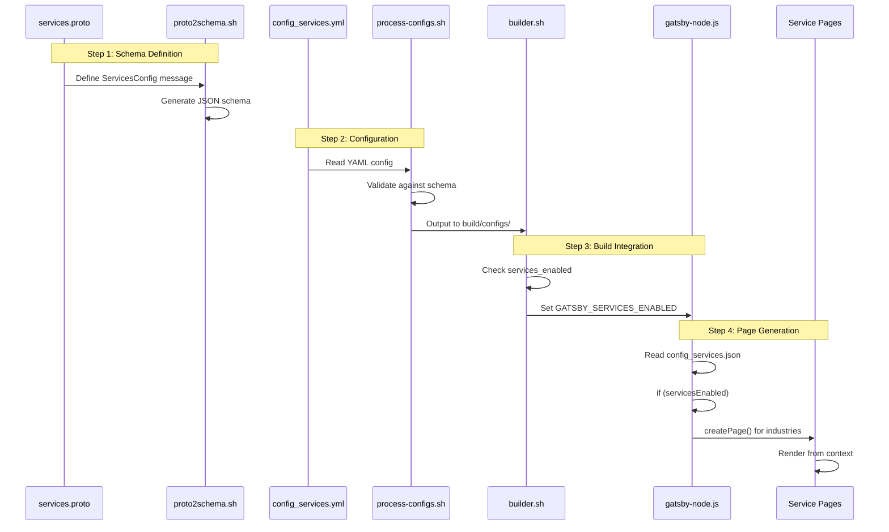
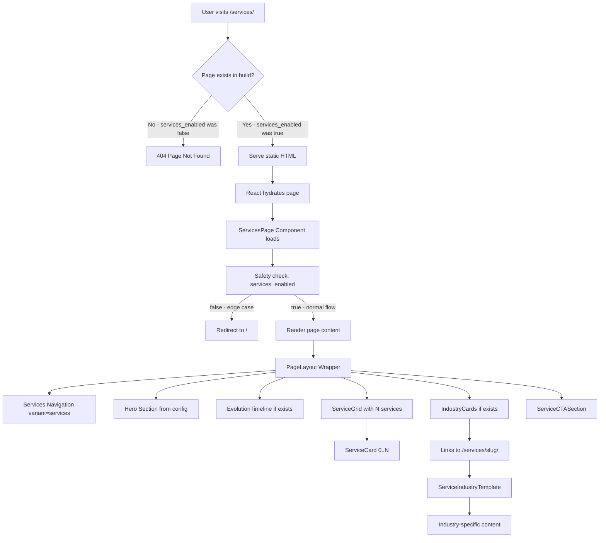
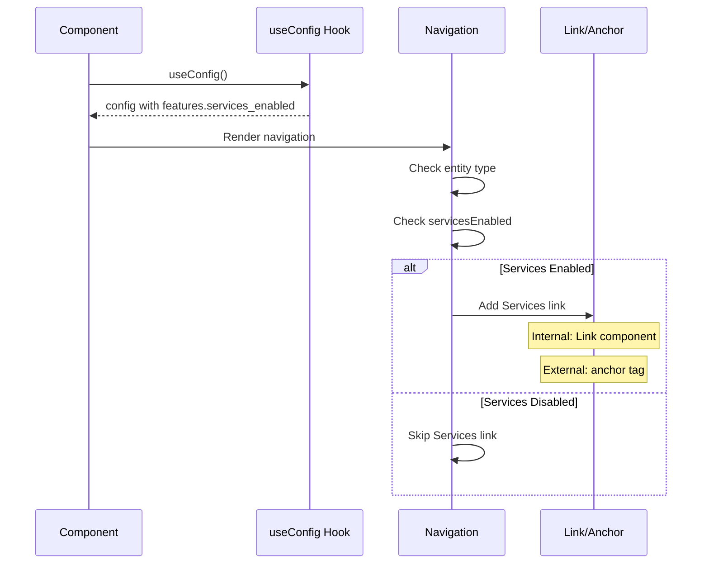
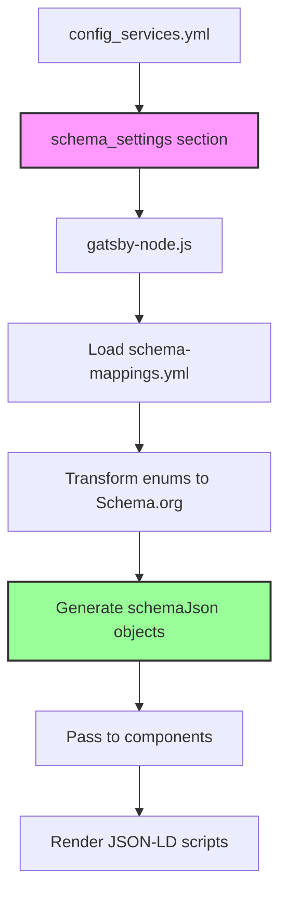
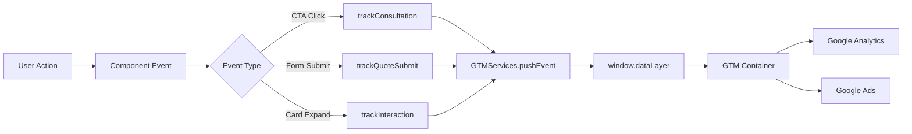
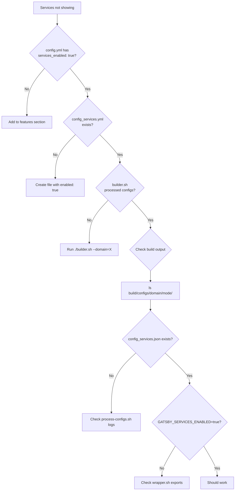
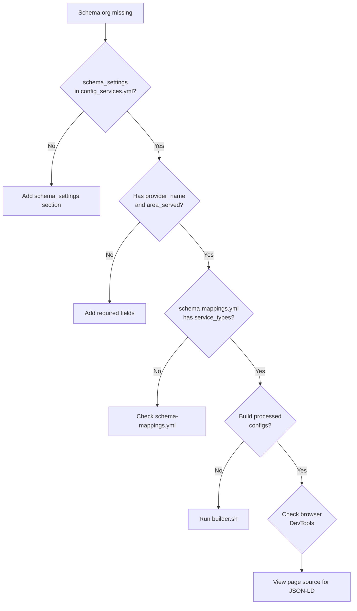

# SERVICES.md - AI Transformation Services System

Dynamic, configuration-driven service pages for the getHarsh ecosystem - from AI consulting to industry-specific solutions.

## 🚨 Critical Guardrails

### NEVER Do This
❌ **Hardcode service names or counts** - Everything from config  
❌ **Assume industries exist** - They're dynamically generated  
❌ **Mix entity services** - RTEPL ≠ DSPL services  
❌ **Skip services_enabled check** - Always verify first  
❌ **Create services.tsx in pages/** - Use index.tsx in services/  
❌ **Hardcode Schema.org values** - Use schema_settings from config  

### ALWAYS Do This
✅ **Enable in 3 places** - domain.proto, config.yml, config_services.yml  
✅ **Handle 0 services** - Components must not break  
✅ **Test varied counts** - 0, 1, 3, 10+ services  
✅ **Configure Schema.org** - schema_settings section required  
✅ **Use builder.sh** - Never bypass the build system  
✅ **Let build transform** - Schema.org generated at build time  

## Architecture & Sequence

> **Key Concept**: Services are controlled at **build time**. If `services_enabled = false`, the `/services/` pages are **not generated** and will return 404. This is a static site - pages either exist or don't exist after build.

### Build-Time Flow



### Page Serving Flow (Post-Build)



## Implementation Checklist

### 1. Enable Services (3 Required Steps)

#### Step 1.1: Proto Schema
In [`domain.proto`](../config/schema/domain.proto) - `DomainFeatures` message:
```protobuf
message DomainFeatures {
  bool services_enabled = 4;  // ✅ Added
}
```

#### Step 1.2: Domain Configuration
Edit `[domain]/config.yml`:
```yaml
features:
  services_enabled: true  # Required
```
Example: [`rawThoughts.in/config.yml`](../../rawThoughts.in/config.yml) - `features` section

#### Step 1.3: Services Configuration
Create `[domain]/config_services.yml`:
```yaml
enabled: true  # Required
schema_settings:  # Required for Schema.org
  provider_type: "Organization"
  provider_name: "Your Legal Entity"
  offer_catalog_name: "Service Catalog"
  area_served: "Worldwide"
  available_languages: ["en"]
services: []   # Can be empty
```
Example: [`rawThoughts.in/config_services.yml`](../../rawThoughts.in/config_services.yml)

### 2. Component Structure

```
src/src/components/services/
├── ServiceCard.tsx         # Individual service (with schemaJson)
├── ServiceGrid.tsx         # Adaptive grid (1-N columns)
├── EvolutionTimeline.tsx   # Era progression (0-N eras)
├── IndustryCards.tsx       # Industry links (with schemaJson)
├── ServiceCTASection.tsx   # Conversion CTAs (contact funnel)
├── ServiceCTA.tsx          # Blog integration (3 variants)
└── index.ts               # Barrel export
```

### 3. Page & Template Structure

```
src/src/
├── pages/
│   └── services/
│       └── index.tsx      # Main services page
└── templates/
    └── service-industry.tsx  # Industry pages (dynamic)
```

## Configuration Deep Dive

### ServicesConfig Schema ([services.proto](../config/schema/services.proto))

```protobuf
message ServicesConfig {
  bool enabled = 1;                        // Master switch
  string nav_label = 2;                    // Navigation text
  ServicesPageSettings main_page = 3;      // Main page config
  repeated Service services = 4;           // Service array
  repeated IndustryPage industry_pages = 5; // Industry pages
  ServiceCTASettings cta_settings = 6;     // CTAs
  SchemaOrgSettings schema_settings = 7;   // SEO (CRITICAL!)
  BlogIntegrationSettings blog_integration = 8;
  AnalyticsSettings analytics = 9;
  string terms_url = 10;
  string privacy_url = 11;
}
```

#### Critical: SchemaOrgSettings

```protobuf
message SchemaOrgSettings {
  string provider_type = 1;         // "Organization" or "Person"
  string provider_name = 2;         // Legal entity name
  string offer_catalog_name = 3;    // Service catalog name
  string area_served = 4;           // "Worldwide", "India", etc.
  repeated string available_languages = 5;  // ["en", "hi"]
  map<string, string> custom_properties = 6;  // Extensions
}
```

### Processing Pipeline ([process-configs.sh](../config/tools/process-configs.sh))

Services processing in `process_domain()` function:
```bash
# Read config_services.yml
if [[ -f "$domain_path/config_services.yml" ]]; then
    services_content=$(cat "$domain_path/config_services.yml")
fi

# Process and validate
apply_phase_processing "$temp_services" "$processed_services"

# Output to build directory
output_services="$mode_dir/config_services.yml"
```

### Page Generation ([gatsby-node.js](../gatsby-node.js))

Service page creation in `createPages` API:
```javascript
// Check if enabled
const servicesEnabled = process.env.GATSBY_SERVICES_ENABLED === 'true'

// Load schema mappings for transformations
const schemaMappings = yaml.load(fs.readFileSync('schema-mappings.yml'))

// Transform services with Schema.org at build time
if (servicesConfig.services && schemaMappings.service_types) {
  const schemaSettings = servicesConfig.schema_settings || {}
  
  servicesConfig.services = servicesConfig.services.map(service => ({
    ...service,
    schemaJson: buildServiceSchema(service, schemaSettings, schemaMappings)
  }))
  
  // Build page-level Schema with OfferCatalog
  servicesConfig.pageSchemaJson = buildPageSchema(servicesConfig, schemaMappings)
}

// Create industry pages with transformed schemas
if (servicesConfig.industry_pages) {
  for (const industry of servicesConfig.industry_pages) {
    createPage({
      path: `/services/${industry.slug}/`,
      component: industryTemplate,
      context: { 
        industry: { ...industry, schemaJson },
        servicesConfig,
        domainConfig 
      }
    })
  }
}
```

#### Schema.org Build-Time Transformation

The build system generates **two levels** of Schema.org:

1. **Page-level Schema** (`pageSchemaJson`):
   - Full OfferCatalog with all services
   - Provider info from `schema_settings`
   - Area served and languages from config
   - Comprehensive service catalog structure

2. **Individual Service Schemas** (`schemaJson` per service):
   - Correct @type from enum mapping
   - Service-specific details
   - Price ranges when configured
   - All from configuration, nothing hardcoded

## Navigation Integration

### Entity-Aware Navigation ([top-navigation.tsx](../src/src/components/navigation/top-navigation.tsx))

| Entity | Variant Case | Services Link | Target |
|--------|-------------|--------------|--------|
| domain | `case "domain"` | When `servicesEnabled` | `/services/` |
| blog | `case "blog"` | When `servicesEnabled` | `[domain]/services/` |
| project | `case "project"` | When `servicesEnabled` | `[domain]/services/` |
| docs | `case "docs"` | When `servicesEnabled` | `[domain]/services/` |
| services | `case "services"` | Always (highlighted) | Current page |

### Navigation Sequence



## Schema.org Configuration Flow

### Required Configuration

In `config_services.yml`, the `schema_settings` section is **mandatory**:

```yaml
schema_settings:
  provider_type: "Organization"  # Or "Person"
  provider_name: "Your Legal Entity Name"
  offer_catalog_name: "Your Service Catalog Name"
  area_served: "Worldwide"  # Or specific region
  available_languages:
    - "en"
    - "hi" 
  custom_properties:  # Optional extensions
    someProperty: "someValue"
```

### Transformation Pipeline



### Component Usage

Components are **dumb consumers** - they only render pre-built Schema.org:

```typescript
// ServiceCard receives schemaJson
interface ServiceCardProps {
  service: {
    schemaJson?: any  // Pre-built from gatsby-node
  }
}

// Just render it
{service.schemaJson && (
  <script 
    type="application/ld+json"
    dangerouslySetInnerHTML={{ __html: JSON.stringify(service.schemaJson) }}
  />
)}
```

## GTM Analytics Flow

### Event Tracking ([gtm-services.js](../src/utils/gtm-services.js))



### Conversion Events

| Event | Code Location | Trigger | Value |
|-------|--------------|---------|-------|
| `consultation_booking_click` | `trackConsultation()` | Primary CTA | High |
| `quote_form_submit` | `trackQuoteSubmit()` | Secondary CTA | Medium |
| `service_interest` | `trackInteraction()` | Card interaction | Low |

## Troubleshooting Workflows

### Services Not Appearing



### Schema.org Not Appearing



Debug commands:
```bash
# Check if schema_settings exists
grep -A5 "schema_settings:" config_services.yml

# Verify build output has schemaJson
cat build/configs/[domain]/LOCAL/config_services.json | jq '.services[0].schemaJson'

# Check page source in browser
curl -s http://localhost:8000/services/ | grep -o '<script type="application/ld+json".*</script>'
```

### Industry Pages 404

1. **Verify slug in config** ([config_services.yml](../../rawThoughts.in/config_services.yml)):
   ```yaml
   industry_pages:
     - slug: "customer-support"  # → /services/customer-support/
   ```

2. **Check build logs**:
   ```bash
   npm run build 2>&1 | grep "Creating industry page"
   # Should show: "Creating industry page: /services/customer-support/"
   ```

3. **Verify page generation**:
   ```bash
   ls -la public/services/*/
   # Should list industry page directories
   ```

## Blog Integration

### ServiceCTA Component

The `ServiceCTA` component provides blog integration with 3 variants:

```typescript
// Inline variant - subtle within content
<ServiceCTA 
  variant="inline"
  servicesEnabled={config.features.services_enabled}
/>

// Block variant - prominent card
<ServiceCTA 
  variant="block"
  servicesEnabled={config.features.services_enabled}
/>

// Sidebar variant - compact widget
<ServiceCTA 
  variant="sidebar"
  servicesEnabled={config.features.services_enabled}
/>
```

### Blog Configuration

In `config_services.yml`:
```yaml
blog_integration:
  enable_service_links: true
  default_cta_text: "Learn how AI can help →"
  link_style: "card"  # inline, card, banner
  link_position: "after-intro"
  add_schema_markup: true
```

### Conversion Funnel

All service CTAs redirect to `/contact/` for unified conversion:
- Quote forms → `/contact/?action=quote`
- Calendar booking → `/contact/?action=schedule`
- Consultation → `/contact/`

No embedded forms - single conversion point for tracking.

## Maintenance Procedures

### Adding a New Service

```bash
# 1. Edit configuration
vim [domain]/config_services.yml

# 2. Add service (respect YAML structure)
services:
  - id: "new-service"        # Unique ID
    title: "New Service"      # Display title
    tagline: "Tagline"        # Short description
    description: "Full desc"  # Detailed description
    display_order: 4          # Sort order

# 3. Process configuration
./getHarsh/builder.sh --domain=[domain] --mode=LOCAL

# 4. Verify processing
cat build/configs/[domain]/LOCAL/config_services.json | jq '.services'

# 5. Test locally
cd getHarsh/src && npm run develop
# Visit http://localhost:8000/services/
```

### Adding an Industry Page

```bash
# 1. Add to industry_pages array
industry_pages:
  - slug: "finance"                     # URL segment
    hero_title: "FinTech AI Solutions"  # Page title
    hero_subtitle: "Transform finance"   # Subtitle
    benefits:                           # Benefits list
      - "Risk analysis"
      - "Fraud detection"
    service_ids:                        # Related services
      - "ai-growth"
      - "ai-intelligence"

# 2. Build and verify
./getHarsh/builder.sh --domain=[domain] --mode=LOCAL

# 3. Check gatsby-node.js output
# Look for: "Created N industry service pages"

# 4. Test page
# Visit http://localhost:8000/services/finance/
```

### Modifying CTAs

In [`config_services.yml`](../../rawThoughts.in/config_services.yml) - `cta_settings` section:

```yaml
cta_settings:
  primary:
    text: "Book Consultation"      # Button text
    action: "link"                 # Action type
    target: "/contact#appointment" # Target
    style: "primary"               # Visual style
    event_name: "consultation_click" # GTM event
    event_params:                  # GTM params
      source: "services_page"
```

Action types:
- `link` → Navigation (internal/external)
- `form` → Embedded form
- `modal` → Modal dialog
- `calendar` → Booking widget

## Future Tasks

### Low Priority (Nice to have)

These enhancements can be implemented when all other ecosystem tasks are complete:

1. **Video Content Integration**
   - Service explanation videos
   - Client testimonial videos
   - Embedded YouTube/Vimeo players
   - Video schema markup

2. **Enhanced Animations**
   - Timeline progression effects
   - Card hover animations
   - Scroll-triggered reveals
   - Page transitions

3. **Testimonial System**
   - Client success stories
   - Review schema markup
   - Rotating testimonials
   - Industry-specific social proof

4. **A/B Testing Framework**
   - CTA variation testing
   - Conversion optimization
   - Analytics integration

5. **Advanced Case Studies**
   - Dedicated case study pages
   - Before/after comparisons
   - ROI calculators
   - Interactive demos

## Cross-References

### Configuration Files
- [services.proto](../config/schema/services.proto) - `ServicesConfig` & `SchemaOrgSettings`
- [domain.proto](../config/schema/domain.proto) - `DomainFeatures.services_enabled`
- [schema-mappings.yml](../config/schema/schema-mappings.yml) - Enum to Schema.org mappings
- [ecosystem-defaults.yml](../config/ecosystem-defaults.yml) - Default services settings
- [rawThoughts.in/config.yml](../../rawThoughts.in/config.yml) - Example with services enabled
- [rawThoughts.in/config_services.yml](../../rawThoughts.in/config_services.yml) - Full service configuration with schema_settings

### Processing Scripts
- [process-configs.sh](../config/tools/process-configs.sh) - `process_domain()` function
- [builder.sh](../builder.sh) - Phase orchestration
- [proto2schema.sh](../config/tools/proto2schema.sh) - Schema generation

### Implementation Files
- [gatsby-node.js](../gatsby-node.js) - Schema.org transformation & page creation
- [top-navigation.tsx](../src/src/components/navigation/top-navigation.tsx) - Navigation variants
- [services/index.tsx](../src/src/pages/services/index.tsx) - Main services page with pageSchemaJson
- [service-industry.tsx](../src/src/templates/service-industry.tsx) - Industry template with schemaJson
- [ServiceCTA.tsx](../src/src/components/services/ServiceCTA.tsx) - Blog integration component

### Tracking & Analytics
- [useServiceTracking.js](../src/hooks/useServiceTracking.js) - React tracking hook
- [gtm-services.js](../src/utils/gtm-services.js) - GTM service utilities

### Documentation
- [USE-CASE.md](./USE-CASE.md) - Services component specifications
- [CMS.md](./CMS.md) - Related CMS system
- [BUILD.md](../BUILD.md) - Build pipeline phases
- [GUARDRAILS.md](../GUARDRAILS.md) - System guardrails

---

*Services system: Configuration-driven, entity-aware, AI-optimized. Schema.org from config, blog integration ready, conversion funnel unified. No hardcoding, just YAML and magic.*